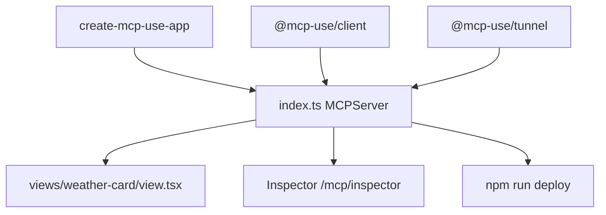

# mcp-use/mcp-use

> Framework TypeScript pour construire, tester et déployer des serveurs MCP avec interfaces React intégrées.

## Le problème
Écrire un serveur MCP à la main demande du câblage : schémas, transport, inspection, interface visuelle, tunnel pour tester avec ChatGPT ou Claude.

## Ce que ça fait vraiment
On déclare des outils typés avec zod (`server.tool`), éventuellement liés à une vue React (`views/<nom>/view.tsx`). Le projet fournit un Inspector local, un client CLI, une capture d'écran des vues, un tunnel public et une commande de déploiement vers la plateforme Manufact.

## Comment c'est branché


## Essayer
```bash
npx -y create-mcp-use-app@latest
npm run dev
npm run build
npx mcp-use client connect local http://localhost:3000/mcp
npx mcp-use client local tools list
npm run deploy
```

## Coût et pièges
Gratuit en local. Le déploiement géré passe par Manufact (annoncé gratuit pour l'observabilité de base) ; l'auto-hébergement est documenté. Migration v1 vers v2 à prévoir.

## Ce que ce n'est pas
Pas un client LLM complet : l'agent est un paquet à part. Les chiffres de benchmark du README viennent de l'auteur.

## Alternatives
FastMCP TS, SDK officiel v2, xmcp, Skybridge, mcp-handler (comparés dans le README).

## Pour toi
À surveiller : utile si tu exposes des outils data à un agent avec une interface, mais le gain tient au TypeScript et aux vues, pas au cœur MCP.

