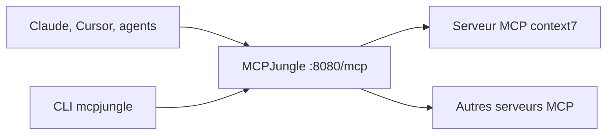

# mcpjungle/MCPJungle

> Self-hosted MCP gateway: a single access point for all your MCP servers.

## The problem
Each AI client has to configure each MCP server separately: duplicates, no access control, installations that are hard to reproduce.

## What it actually does
You register your MCP servers once in MCPJungle, and Claude, Cursor or your agents connect to a single HTTP endpoint (`/mcp`). It unifies the discovery of tools, prompts and resources, and offers tool groups to limit what each client sees. The README mentions access control and observability for shared use.

## How it is wired

Simplified diagram based on the sheet, no diagram provided.

## Trying it
```bash
curl -O https://raw.githubusercontent.com/mcpjungle/MCPJungle/refs/heads/main/docker-compose.yaml
docker compose up -d
brew install mcpjungle/mcpjungle/mcpjungle
mcpjungle register --name context7 --url https://mcp.context7.com/mcp
```

## Cost and gotchas
Free, with Docker. The registered MCP servers may have their own costs or keys. Client configuration goes through `mcp-remote` over local HTTP.

## What it is not
Neither an MCP server that does useful work by itself, nor an agent. The MPL-2.0 license requires you to share modifications to the affected files if you redistribute.

## Alternatives
No alternative named in the README.

## For you
Adopt if you juggle several MCP servers and several clients: the Docker installation is short and the configuration gain is immediate.
