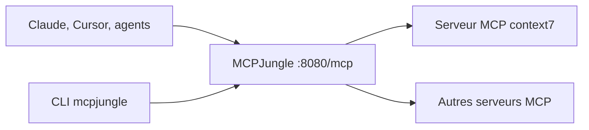

# mcpjungle/MCPJungle

> Passerelle MCP auto-hébergée : un seul point d'accès pour tous tes serveurs MCP.

## Le problème
Chaque client IA doit configurer chaque serveur MCP séparément : doublons, contrôle d'accès absent, installations difficiles à reproduire.

## Ce que ça fait vraiment
Tu enregistres tes serveurs MCP une fois dans MCPJungle, et Claude, Cursor ou tes agents se connectent à un unique endpoint HTTP (`/mcp`). Il unifie la découverte des outils, prompts et ressources, et propose des groupes d'outils pour limiter ce que chaque client voit. Le README mentionne contrôle d'accès et observabilité pour un usage partagé.

## Comment c'est branché

Schéma simplifié d'après la fiche, sans diagramme fourni.

## Essayer
```bash
curl -O https://raw.githubusercontent.com/mcpjungle/MCPJungle/refs/heads/main/docker-compose.yaml
docker compose up -d
brew install mcpjungle/mcpjungle/mcpjungle
mcpjungle register --name context7 --url https://mcp.context7.com/mcp
```

## Coût et pièges
Gratuit, avec Docker. Les serveurs MCP enregistrés peuvent avoir leurs propres coûts ou clés. La configuration cliente passe par `mcp-remote` en HTTP local.

## Ce que ce n'est pas
Ni un serveur MCP qui fait un travail utile en soi, ni un agent. La licence MPL-2.0 impose de partager les modifications des fichiers concernés si tu redistribues.

## Alternatives
Aucune alternative nommée dans le README.

## Pour toi
À adopter si tu jongles avec plusieurs serveurs MCP et plusieurs clients : l'installation Docker est courte et le gain de configuration est immédiat.

