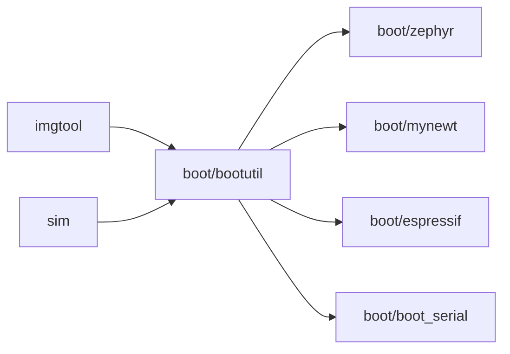

# mcu-tools/mcuboot

> Secure bootloader for 32-bit microcontrollers, independent of the operating system, for embedded firmware.

## The problem
Updating a microcontroller's firmware safely requires a bootloader that verifies images.

## What it actually does
Defines a common infrastructure and the flash memory layout, verifies and activates signed images. Relies on porting layers: Zephyr, Mynewt, NuttX, RIOT (boot target only), Mbed OS, Espressif, Cypress/Infineon. `imgtool` signs images; `sim` simulates the bootloader. Version 2.5.0.

## How it is wired

## Trying it
No command documented in the README: it points to the per-system guides (Zephyr, Mynewt, etc.).

## Cost and gotchas
Free. Requires a port for the target hardware and an embedded toolchain.

## What it is not
Not an operating system: it depends on the one used by the project.

## Alternatives
No alternative named in the README.

## For you
Ignore: embedded firmware, outside the data/AI/MLOps profile (except for an embedded AI project).
