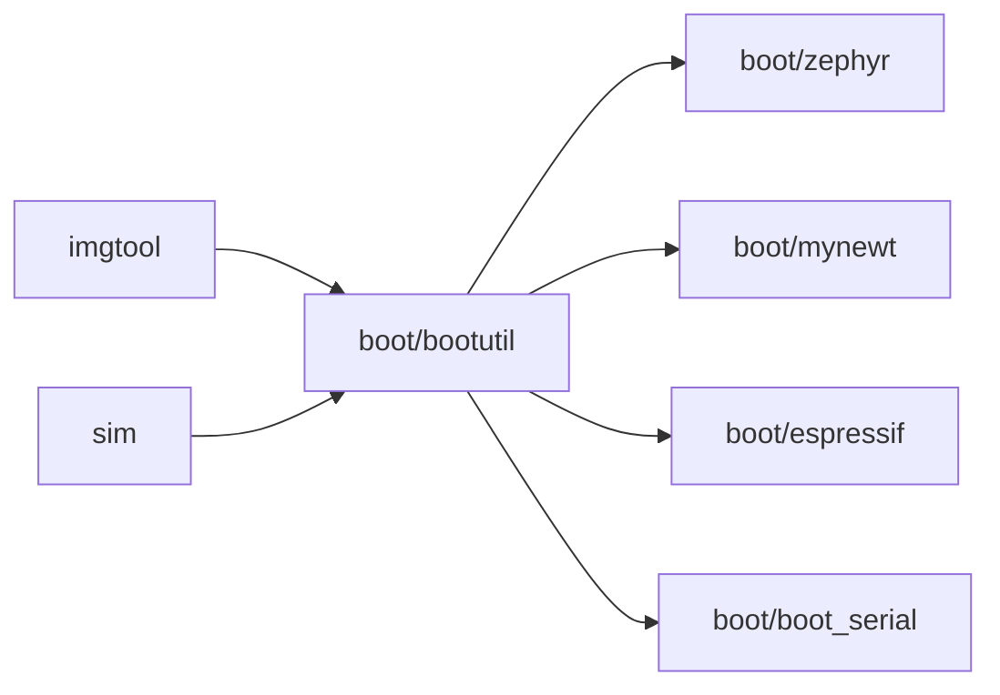

# mcu-tools/mcuboot

> Bootloader sécurisé pour microcontrôleurs 32 bits, indépendant du système d'exploitation, pour firmwares embarqués.

## Le problème
Mettre à jour un firmware de microcontrôleur en toute sécurité exige un bootloader qui vérifie les images.

## Ce que ça fait vraiment
Définit une infrastructure commune et la disposition de la mémoire flash, vérifie et active les images signées. S'appuie sur des couches de portage : Zephyr, Mynewt, NuttX, RIOT (cible de démarrage seulement), Mbed OS, Espressif, Cypress/Infineon. `imgtool` signe les images ; `sim` simule le bootloader. Version 2.5.0.

## Comment c'est branché

## Essayer
Aucune commande documentée dans le README : renvoie aux guides par système (Zephyr, Mynewt, etc.).

## Coût et pièges
Gratuit. Exige un portage pour le matériel visé et une chaîne de compilation embarquée.

## Ce que ce n'est pas
Pas un système d'exploitation : il dépend de celui du projet.

## Alternatives
Aucune alternative nommée dans le README.

## Pour toi
À ignorer : firmware embarqué, hors profil data/IA/MLOps (sauf projet d'IA embarquée).

