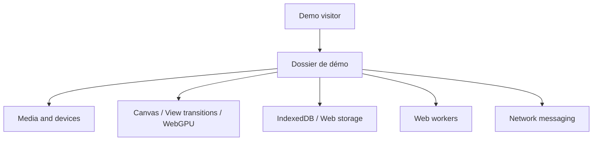

# mdn/dom-examples

> Standalone code examples accompanying the MDN documentation on the DOM and Web APIs.

## The problem
Some Web API demos do not fit on an MDN page, for technical or security reasons.

## What it actually does
One directory per demo: Abort API, canvas, Web Workers, WebGL, WebGPU (compute and rendering), IndexedDB, Service Worker, View Transitions, Streams, WebXR, notifications, etc. Each demo is independent, with no common orchestrator, and most have a "live" link.

## How it is wired


## Trying it
```bash
# Aucune commande générale : ouvrir les liens « live » du README ; le démo SSE demande un serveur PHP.
```

## Cost and gotchas
Free. The examples are not libraries to install. Most need a recent browser for the experimental APIs.

## What it is not
Not an application or a framework: a collection of independent demos.

## Alternatives
No alternative named in the README (the README prefers putting examples directly in MDN when possible).

## For you
Worth watching: a practical reference if you build web interfaces for your models (WebGPU, Workers, Streams), with no value beyond that.
