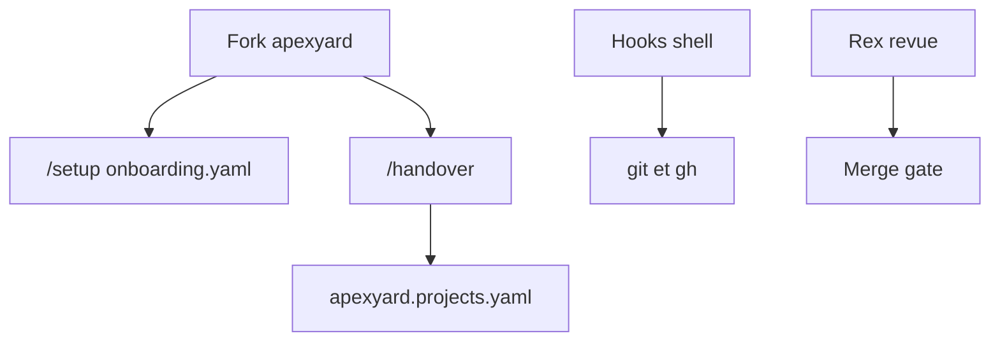

# me2resh/apexyard

> Repository of rules, shell hooks and skills that frame agent-written code all the way to production.

## The problem
An agent produces a prototype quickly, but decisions, reviews, checks and merge approval remain informal.

## What it actually does
- An "ops" repository to fork, with no service to run: markdown files and shell scripts.
- 60 hooks block risky actions: editing without a ticket, merging without double approval, migrations, secrets.
- 20 roles, 69 skills, 23 subagents (including Rex for review) and document templates.
- Project registry in `apexyard.projects.yaml`.

## How it is wired

Simplified diagram based on the sheet, no diagram provided.

## Trying it
```bash
gh repo clone your-org/apexyard
cd apexyard
cp onboarding.example.yaml onboarding.yaml
bash bin/install-opencode-adapter.sh
```
Then `/setup` and `/handover <repo>` in Claude Code.

## Cost and gotchas
Free, but the real cost is that of the agent calls. Designed for Claude Code; other tools go through adapters, with auto-approval settings. The rules are in bash: Git Bash or WSL on Windows.

## What it is not
Not a service nor a guarantee: the hooks block commands, they do not prove code quality.

## Alternatives
No alternative named in the README.

## For you
Worth watching: the merge gate with human approval of the exact commit is a good idea to borrow, but the whole is heavy and recent.
