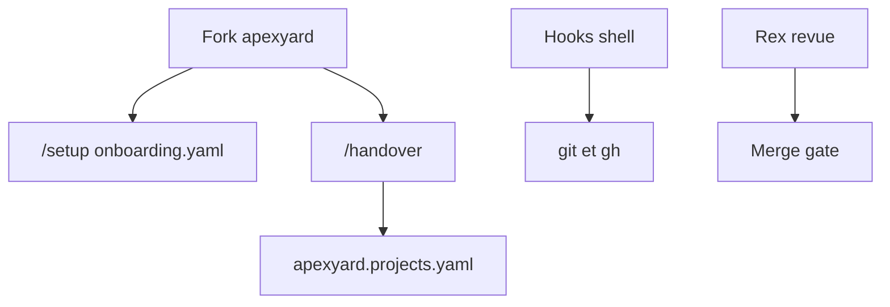

# me2resh/apexyard

> Dépôt de règles, hooks shell et skills qui encadrent du code écrit par agent jusqu'à la production.

## Le problème
Un agent produit vite un prototype, mais décisions, revues, contrôles et approbation de merge restent informels.

## Ce que ça fait vraiment
- Un dépôt « ops » à forker, sans service à lancer : fichiers markdown et scripts shell.
- 60 hooks bloquent les actions risquées : édition sans ticket, merge sans double validation, migrations, secrets.
- 20 rôles, 69 skills, 23 sous-agents (dont Rex pour la revue) et des modèles de documents.
- Registre des projets dans `apexyard.projects.yaml`.

## Comment c'est branché

Schéma simplifié d'après la fiche, sans diagramme fourni.

## Essayer
```bash
gh repo clone your-org/apexyard
cd apexyard
cp onboarding.example.yaml onboarding.yaml
bash bin/install-opencode-adapter.sh
```
Puis `/setup` et `/handover <repo>` dans Claude Code.

## Coût et pièges
Gratuit, mais le coût réel est celui des appels d'agent. Pensé pour Claude Code ; les autres outils passent par des adaptateurs, avec réglage d'auto-approbation. Les règles sont en bash : Git Bash ou WSL sous Windows.

## Ce que ce n'est pas
Pas un service ni une garantie : les hooks bloquent des commandes, ils ne prouvent pas la qualité du code.

## Alternatives
Aucune alternative nommée dans le README.

## Pour toi
À surveiller : la porte de merge avec validation humaine du commit exact est une bonne idée à reprendre, mais l'ensemble est lourd et récent.

