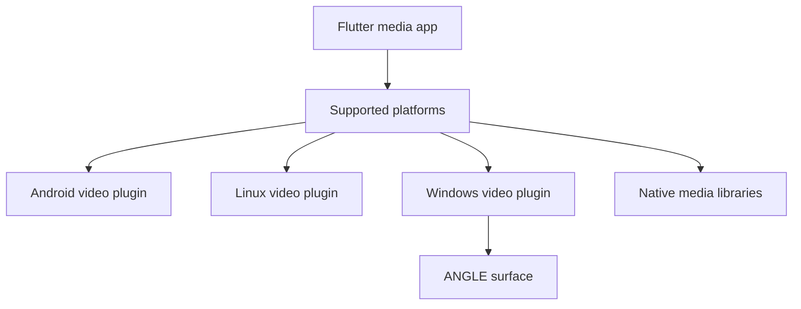

# media-kit/media-kit

> A cross-platform Flutter and Dart library for audio and video playback.

## The problem
Flutter video players cover all platforms poorly, or depend on a different native engine on each one.

## What it actually does
The `media_kit` package provides a `Player` (playback, playlist, speed, pitch, tracks, subtitles, screenshots) and `media_kit_video` provides a `Video` widget with GPU acceleration. Native library packages (`media_kit_libs_video` or `_audio`) cover Android, iOS, macOS, Windows, Linux and the web.

## How it is wired
Diagram taken from the code, simplified.



## Trying it
```bash
# pubspec.yaml : media_kit, media_kit_video, media_kit_libs_video
# Dart : MediaKit.ensureInitialized(); final player = Player();
```

## Cost and gotchas
Free (MIT). The audio and video native library packages must not be mixed. Performance in Release mode is much better than in Debug. Every `Player` must be released with `dispose`.

## What it is not
Not a ready-to-use player: it is a library for Flutter developers. The Dart implementation of `Player` is outside the repository provided for the architecture.

## Alternatives
No alternative named in the README.

## For you
Ignore: only useful if you are building a Flutter application with media playback, which is outside your data and AI profile.
