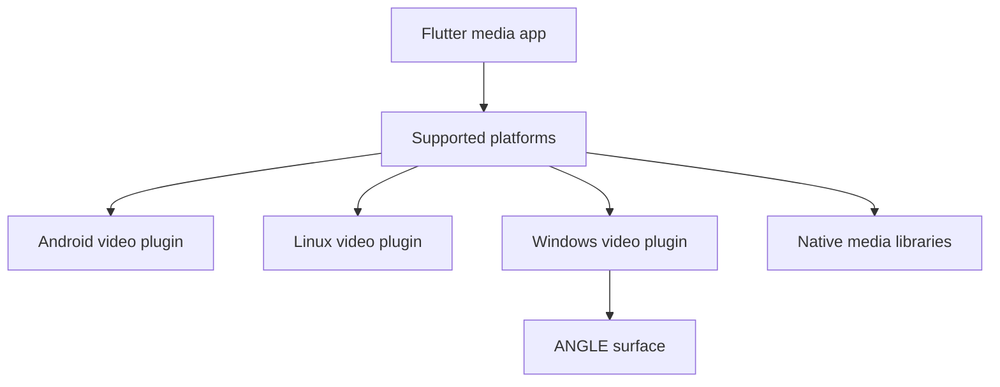

# media-kit/media-kit

> Une bibliothèque Flutter et Dart de lecture audio et vidéo multiplateforme.

## Le problème
Les lecteurs vidéo Flutter couvrent mal toutes les plateformes, ou dépendent d'un moteur natif différent sur chacune.

## Ce que ça fait vraiment
Le paquet `media_kit` fournit un `Player` (lecture, playlist, vitesse, hauteur, pistes, sous-titres, captures) et `media_kit_video` un widget `Video` avec accélération GPU. Des paquets de bibliothèques natives (`media_kit_libs_video` ou `_audio`) couvrent Android, iOS, macOS, Windows, Linux et le web.

## Comment c'est branché
Diagramme tiré du code, simplifié.



## Essayer
```bash
# pubspec.yaml : media_kit, media_kit_video, media_kit_libs_video
# Dart : MediaKit.ensureInitialized(); final player = Player();
```

## Coût et pièges
Gratuit (MIT). Les paquets audio et vidéo des bibliothèques natives ne doivent pas être mélangés. Les performances en mode Release sont nettement meilleures qu'en Debug. Il faut libérer chaque `Player` avec `dispose`.

## Ce que ce n'est pas
Pas un lecteur prêt à l'emploi : c'est une bibliothèque pour développeurs Flutter. L'implémentation Dart de `Player` est hors du dépôt fourni pour l'architecture.

## Alternatives
Aucune alternative nommée dans le README.

## Pour toi
À ignorer : utile uniquement si tu construis une application Flutter avec de la lecture média, ce qui sort de ton profil data et IA.

