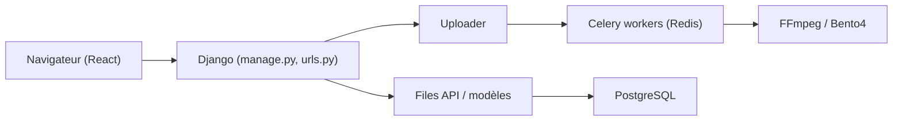

# mediacms-io/mediacms

> Self-hosted video and media CMS, built with Django and React, for internal or educational portals.

## The problem
Host and share videos, audio, images and PDFs without entrusting them to an external platform.

## What it actually does
Django application and REST API: chunked, resumable upload, asynchronous transcoding via Celery (FFmpeg, Bento4, profiles from 144p to 1080p, HLS), subtitles, local transcription with Whisper, video trimming, playlists, role-based access control (RBAC), SAML, LTI 1.3, Moodle plugin. PostgreSQL, Redis, Nginx, Gunicorn.

## How it is wired


## Trying it
```bash
# Aucune commande précise dans le README : passer par la page « Docker Compose »
# de la documentation ou par le script d'installation sur serveur.
```

## Cost and gotchas
Free. Recommended minimum: 4 GB of RAM and 2 to 4 CPUs; disk space to be counted at three times the uploaded volume; more CPU for Whisper. AGPL-3.0 license. The authors also offer paid services.

## What it is not
Not a large-scale streaming service: the README targets small and medium installations.

## Alternatives
No alternative named in the README.

## For you
Worth watching: relevant for archiving training or demo videos internally, with local transcription; heavy for occasional use.
