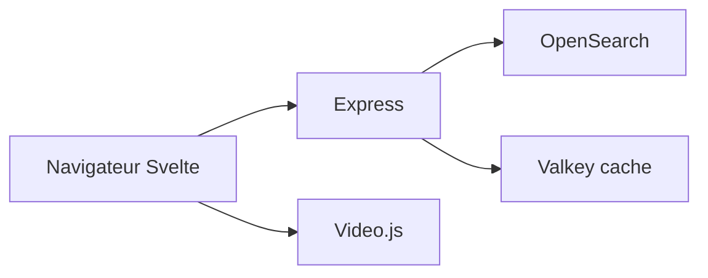

# mediathekview/mediathekviewweb

> Web interface for searching the film list of German public broadcasters' media libraries.

## The problem
Searching public broadcaster programmes without installing the MediathekView desktop client.

## What it actually does
Server-side search with selectors (`!` channel, `#` topic, `+` title, `*` description, `>`/`<` duration), built-in video player, RSS feed per search, sorting. Stack: Node.js, Express, OpenSearch, Valkey; client Svelte, Tailwind, Video.js. README in German.

## How it is wired

## Trying it
No command documented in the README: use mediathekviewweb.de.

## Cost and gotchas
Free. ORF and SRF streams (HLS) cannot be downloaded directly; the README recommends MediathekView, yt-dlp or VLC. Last push in May 2026.

## What it is not
Not a content host: an index of the MediathekView project's film list.

## Alternatives
MediathekView (desktop client), yt-dlp for downloads (cited in the README).

## For you
Ignore: German media library service; only the OpenSearch plus Valkey cache example is instructive.
