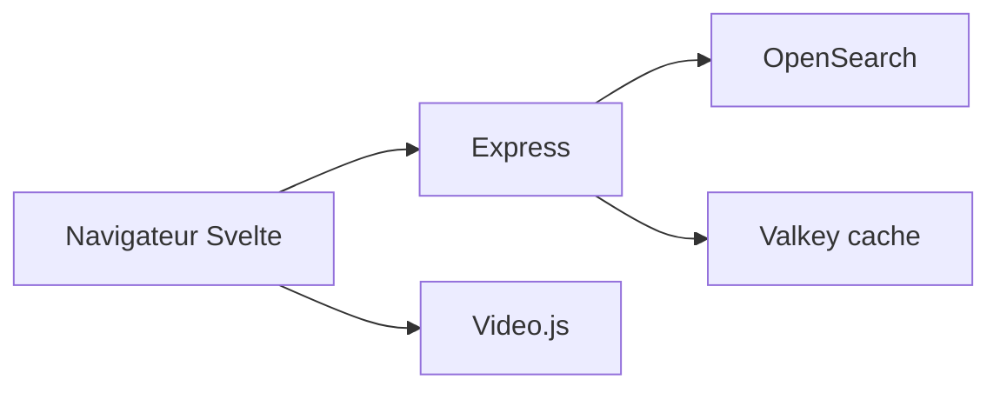

# mediathekview/mediathekviewweb

> Interface web de recherche dans la liste de films des médiathèques publiques allemandes.

## Le problème
Chercher des programmes des chaînes publiques sans installer le client de bureau MediathekView.

## Ce que ça fait vraiment
Recherche côté serveur avec sélecteurs (`!` chaîne, `#` thème, `+` titre, `*` description, `>`/`<` durée), lecteur vidéo intégré, flux RSS par recherche, tri. Pile : Node.js, Express, OpenSearch, Valkey ; client Svelte, Tailwind, Video.js. README en allemand.

## Comment c'est branché

## Essayer
Aucune commande documentée dans le README : utiliser mediathekviewweb.de.

## Coût et pièges
Gratuit. Les flux ORF et SRF (HLS) ne se téléchargent pas directement ; le README conseille MediathekView, yt-dlp ou VLC. Dernier push en mai 2026.

## Ce que ce n'est pas
Pas un hébergeur de contenu : un index de la liste de films du projet MediathekView.

## Alternatives
MediathekView (client de bureau), yt-dlp pour les téléchargements (cités dans le README).

## Pour toi
À ignorer : service de médiathèques allemandes ; seul l'exemple OpenSearch plus cache Valkey est instructif.

