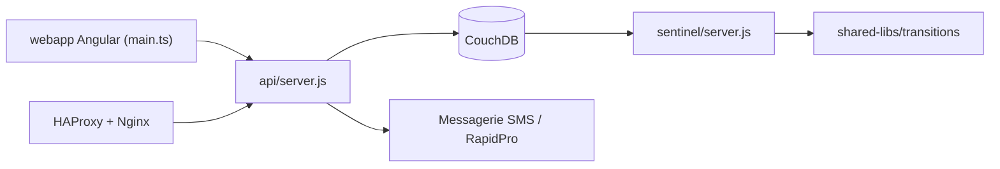

# medic/cht-core

> Offline community health framework for building field applications for health workers.

## The problem
Community health workers often work without a connection, with hierarchies and reporting flows specific to each program.

## What it actually does
Multi-service architecture: an offline Angular client (contacts, reports, tasks, messages), a Node.js API, CouchDB as the source of truth, and Sentinel, a worker that applies transition rules (registrations, alerts, reminders). XForms forms via Enketo, SMS (Africa's Talking, RapidPro), deployable program configurations. Installation with Docker or Kubernetes.

## How it is wired

## Trying it
The README gives no command: it points to the easy deployment instructions (Docker) and to `cht-conf` for configuration.

## Cost and gotchas
Multi-service deployment, with CouchDB to operate; external SMS gateways for messaging. 655 open issues.

## What it is not
It is not a turnkey application: you build your application with the framework and `cht-conf`.

## Alternatives
The README cites no alternatives.

## For you
Ignore: a heavy community health platform, unrelated to day-to-day data/AI/MLOps work, unless you have a dedicated digital health project.
