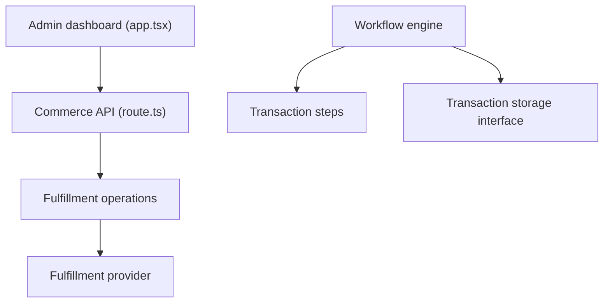

# medusajs/medusa

> Open-source e-commerce platform with a customization framework, for B2B or DTC shops and marketplaces.

## The problem
Rebuilding the building blocks of an online store (products, carts, orders, payments) is expensive on every project.

## What it actually does
Yarn monorepo: Store and Admin APIs, commerce modules (product, cart, order, pricing, payment) and infrastructure modules (event bus, cache, locks, workflow engine). Module providers: Stripe, S3, SendGrid, Redis, OIDC authentication, GitHub, Google. Admin dashboard and UI library.

## How it is wired


## Trying it
```bash
npx create-medusa-app@latest my-medusa-store
```
You need Node.js v22.22.0 or later and a PostgreSQL database.

## Cost and gotchas
Free locally; Medusa Cloud is the managed offering. PostgreSQL required. Enterprise edition features are identified separately in the repository. License present but not identified by GitHub: to be checked.

## What it is not
Not a data or AI tool. The described code does not show the full routing from API to modules.

## Alternatives
No alternative named in the README.

## For you
Outside the data/AI/MLOps scope: ignore, unless you have an e-commerce project; the license still needs checking.
