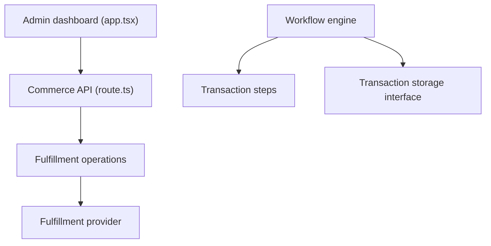

# medusajs/medusa

> Plateforme e-commerce libre avec un cadre de personnalisation, pour boutiques B2B ou DTC et places de marché.

## Le problème
Reconstruire les briques d'un commerce en ligne (produits, paniers, commandes, paiements) coûte cher à chaque projet.

## Ce que ça fait vraiment
Monorepo Yarn : API Store et Admin, modules de commerce (produit, panier, commande, prix, paiement) et d'infrastructure (bus d'événements, cache, verrous, moteur de workflows). Fournisseurs de modules : Stripe, S3, SendGrid, Redis, authentification OIDC, GitHub, Google. Tableau d'administration et bibliothèque d'interface.

## Comment c'est branché


## Essayer
```bash
npx create-medusa-app@latest my-medusa-store
```
Il faut Node.js v22.22.0 ou plus et une base PostgreSQL.

## Coût et pièges
Gratuit en local ; Medusa Cloud est l'offre gérée. PostgreSQL requis. Des fonctions d'édition Enterprise sont identifiées à part dans le dépôt. Licence présente mais non identifiée par GitHub : à vérifier.

## Ce que ce n'est pas
Pas un outil data ou IA. Le code décrit ne montre pas le routage complet API vers modules.

## Alternatives
Aucune alternative nommée dans le README.

## Pour toi
Hors périmètre data/IA/MLOps : à ignorer, sauf projet e-commerce ; la licence reste à vérifier.

