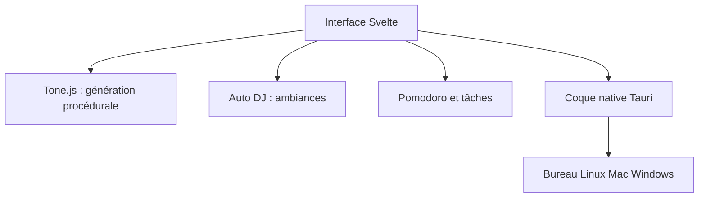

# meel-hd/lofi-engine

> Desktop app that generates lo-fi music on the fly, with ambiences and a Pomodoro timer.

## The problem
Listening to background music while working often means going through an online service, with a login and fixed playlists.

## What it actually does
Generates lo-fi tracks procedurally with Tone.js, with no internet connection. Offers ambiences (rain, wind, sea), an "Auto DJ" mode (music, atmosphere, world, manual) and graphical skins. Adds a Pomodoro timer, tasks, statistics, a zen mode and a mini player. Interface in seven languages.

## How it is wired
Simplified diagram based on the sheet, no diagram provided.


## Trying it
```bash
git clone https://github.com/meel-hd/lofi-engine
cd lofi-engine
pnpm install
pnpm tauri:d
```

## Cost and gotchas
Free, but no binary is announced: you need Node, pnpm, Rust and the Tauri prerequisites for your system. Works offline.

## What it is not
It is not a music library player: everything is generated. It is not a data or AI tool, despite the word "engine".

## Alternatives
No alternative named in the README.

## For you
Ignore for your data / AI / MLOps job: it is a personal productivity toy, only useful if you want a local soundscape.
