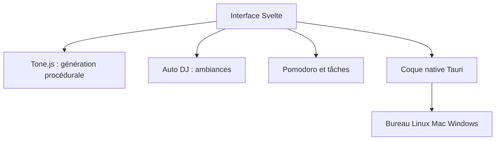

# meel-hd/lofi-engine

> Application de bureau qui génère de la musique lo-fi à la volée, avec ambiances et minuteur Pomodoro.

## Le problème
Écouter de la musique de fond pour travailler oblige souvent à passer par un service en ligne, avec connexion et playlists figées.

## Ce que ça fait vraiment
Génère des pistes lo-fi de façon procédurale avec Tone.js, sans connexion internet. Propose des ambiances (pluie, vent, mer), un mode « Auto DJ » (musique, atmosphère, monde, manuel) et des habillages graphiques. Ajoute un minuteur Pomodoro, des tâches, des statistiques, un mode zen et un mini lecteur. Interface en sept langues.

## Comment c'est branché
Schéma simplifié d'après la fiche, sans diagramme fourni.


## Essayer
```bash
git clone https://github.com/meel-hd/lofi-engine
cd lofi-engine
pnpm install
pnpm tauri:d
```

## Coût et pièges
Gratuit, mais aucun binaire annoncé : il faut Node, pnpm, Rust et les prérequis Tauri de ton système. Fonctionne hors ligne.

## Ce que ce n'est pas
Ce n'est pas un lecteur de bibliothèque musicale : tout est généré. Ce n'est pas un outil data ou IA, malgré le mot « engine ».

## Alternatives
Aucune alternative nommée dans le README.

## Pour toi
À ignorer pour ton métier data / IA / MLOps : c'est un jouet de productivité personnelle, utile seulement si tu veux une ambiance sonore locale.

