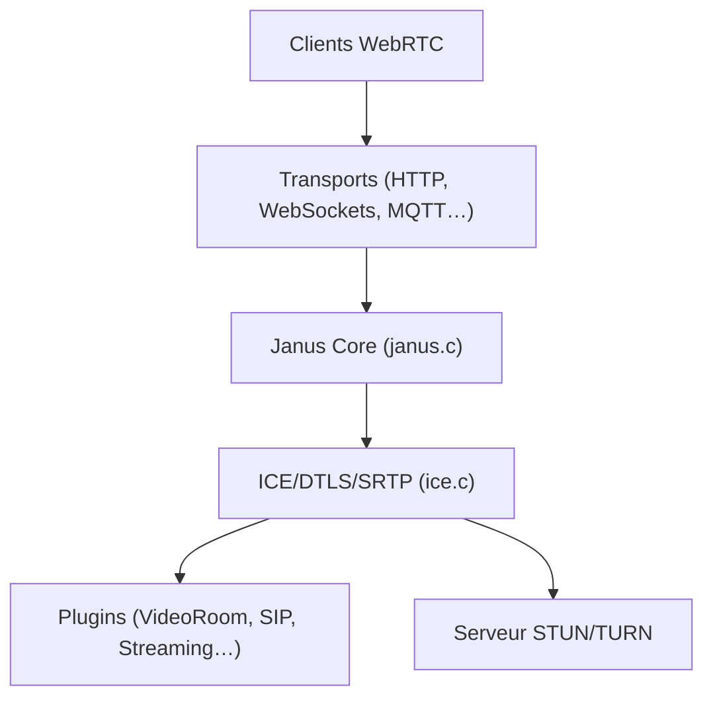

# meetecho/janus-gateway

> General-purpose WebRTC server in C for Linux, for video conferencing and streaming developers.

## The problem
Connecting browsers in real-time audio and video requires a WebRTC server with ICE, DTLS and SRTP.

## What it actually does
A modular server: the core handles sessions, ICE, DTLS, SRTP and RTP routing; plugins provide VideoRoom, AudioBridge, Streaming, SIP, VideoCall, TextRoom, EchoTest and RecordPlay. The API is driven over HTTP, WebSockets, RabbitMQ, MQTT, Unix sockets or Nanomsg. Web demos are in `html`.

## How it is wired


## Trying it
```bash
git clone https://github.com/meetecho/janus-gateway.git
cd janus-gateway
sh autogen.sh
./configure --prefix=/opt/janus
make
make install
make configs
```

## Cost and gotchas
Free. Many dependencies to build (libnice recommended in a recent version, libsrtp 2.x with `--enable-openssl`). Mostly Linux; Windows is not supported. A STUN/TURN server may be needed behind a NAT.

## What it is not
Not a ready-to-use video conferencing application: a server to configure. Third-party `.exe` files are not official.

## Alternatives
No alternative named in the README.

## For you
Ignore: real-time WebRTC infrastructure, outside your data / AI / MLOps work, unless you have a voice or live video project.
