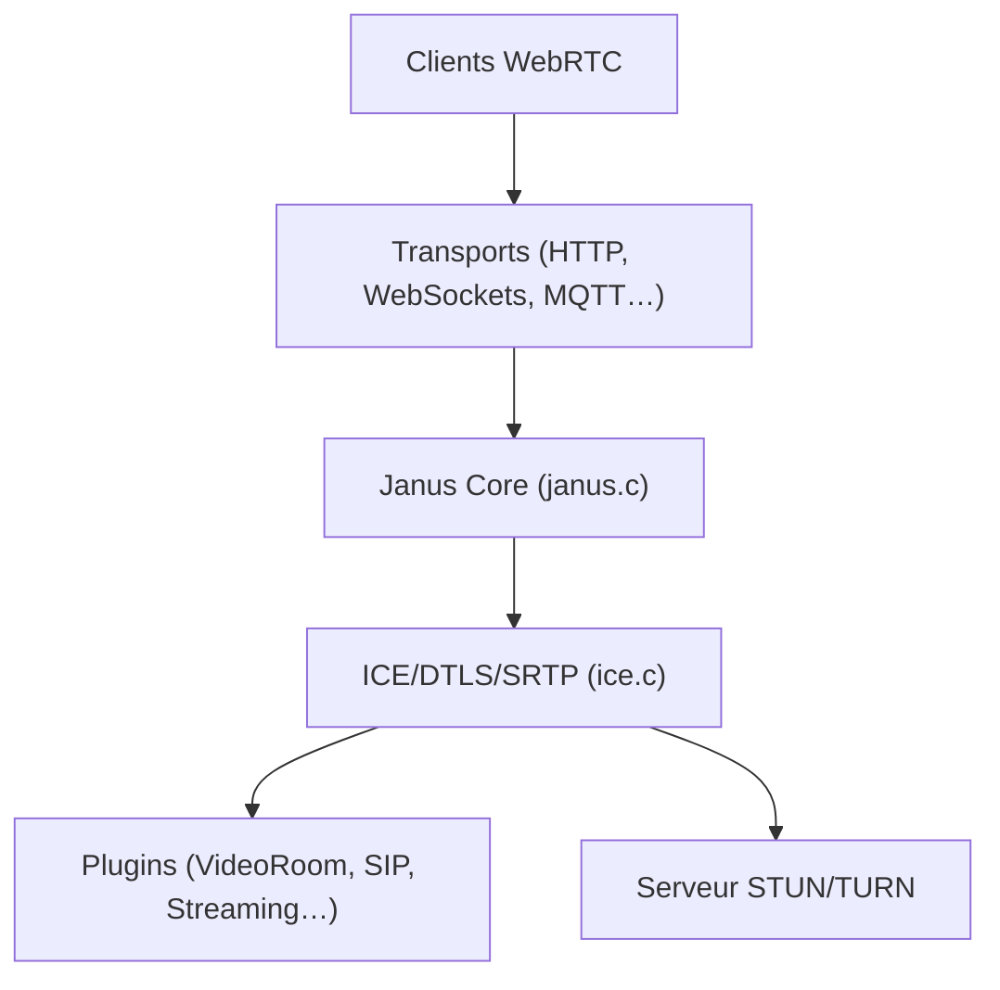

# meetecho/janus-gateway

> Serveur WebRTC généraliste en C pour Linux, pour développeurs de visioconférence et de streaming.

## Le problème
Relier des navigateurs en audio et vidéo temps réel demande un serveur WebRTC avec ICE, DTLS et SRTP.

## Ce que ça fait vraiment
Serveur modulaire : le cœur gère sessions, ICE, DTLS, SRTP et routage RTP ; des plugins fournissent VideoRoom, AudioBridge, Streaming, SIP, VideoCall, TextRoom, EchoTest et RecordPlay. L'API est pilotée par HTTP, WebSockets, RabbitMQ, MQTT, sockets Unix ou Nanomsg. Des démos web sont dans `html`.

## Comment c'est branché


## Essayer
```bash
git clone https://github.com/meetecho/janus-gateway.git
cd janus-gateway
sh autogen.sh
./configure --prefix=/opt/janus
make
make install
make configs
```

## Coût et pièges
Gratuit. Nombreuses dépendances à compiler (libnice recommandé en version récente, libsrtp 2.x avec `--enable-openssl`). Linux surtout ; Windows non pris en charge. Un STUN/TURN peut être nécessaire derrière un NAT.

## Ce que ce n'est pas
Pas une application de visioconférence prête à l'emploi : un serveur à configurer. Les `.exe` tiers ne sont pas officiels.

## Alternatives
Aucune alternative nommée dans le README.

## Pour toi
À ignorer : infrastructure WebRTC temps réel, hors de ton travail data / IA / MLOps, sauf projet vocal ou vidéo en direct.

