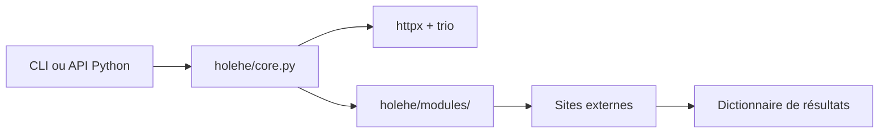

# megadose/holehe

> OSINT tool that checks whether an email address is registered on more than 120 sites.

## The problem
Finding out which online services an email address has an account on, without testing them one by one.

## What it actually does
For each site, a module sends requests (sign-up, login or password recovery) and returns a dictionary: name, rate limit, account existence, partially masked recovery email or phone. The engine (`core.py`) calls the modules in parallel with `httpx` and `trio`. The README claims it does not alert the targeted address.

## How it is wired


## Trying it
```bash
pip3 install holehe
holehe test@gmail.com
docker build . -t my-holehe-image
docker run my-holehe-image holehe test@gmail.com
```

## Cost and gotchas
Free, but sites rate-limit ("change your IP", says the README). Last push in September 2024: the modules depend on third-party pages that change, so wrong or broken results are likely. GPL-3.0: redistribution constraint.

## What it is not
It is not an identity verification tool. Querying a person's accounts without their consent raises a data protection issue.

## Alternatives
The README thanks `socialscan` and `UhOh365` as sources of inspiration; it also offers a Maltego transform (`holehe-maltego`).

## For you
Ignore: an OSINT tool outside the data/AI profile, unmaintained for over a year, with delicate privacy implications.
