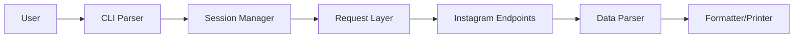

# megadose/toutatis

> Command line that extracts emails, phone numbers and statistics from Instagram accounts, for OSINT.

## The problem
The public profile of an Instagram account does not display its contact details. This script queries Instagram to retrieve public or masked versions of them.

## What it actually does
From a username or an ID, plus the `sessionid` cookie of a logged-in Instagram session, the tool prints in the terminal: name, followers, number of posts, external URL, biography, public email and phone, masked versions of the email and phone, and the profile picture URL. The code fits in a `toutatis` package (`core.py`): argument parsing, HTTPS request, extraction, display.

## How it is wired


## Trying it
```bash
pip install toutatis
toutatis -u username -s instagramsessionid
toutatis -i instagramID -s instagramsessionid
```

## Cost and gotchas
Free, but you need a valid Instagram session cookie, hence a logged-in account. The README does not say what happens to that account under Instagram's rules. Last push in December 2024, 347 open issues: the targeted endpoints may have changed.

## What it is not
It is not a data or analysis tool in the proper sense: it is an extractor of people's contact details. Using it on third-party accounts raises ToS and GDPR questions that the README does not address. The GPL-3.0 license is copyleft, and the README displays a BTC donation address.

## Alternatives
No alternative cited in the README.

## For you
Ignore: outside your data, AI and MLOps scope, dependent on a personal Instagram session, unmaintained since late 2024, and legally delicate to use.
