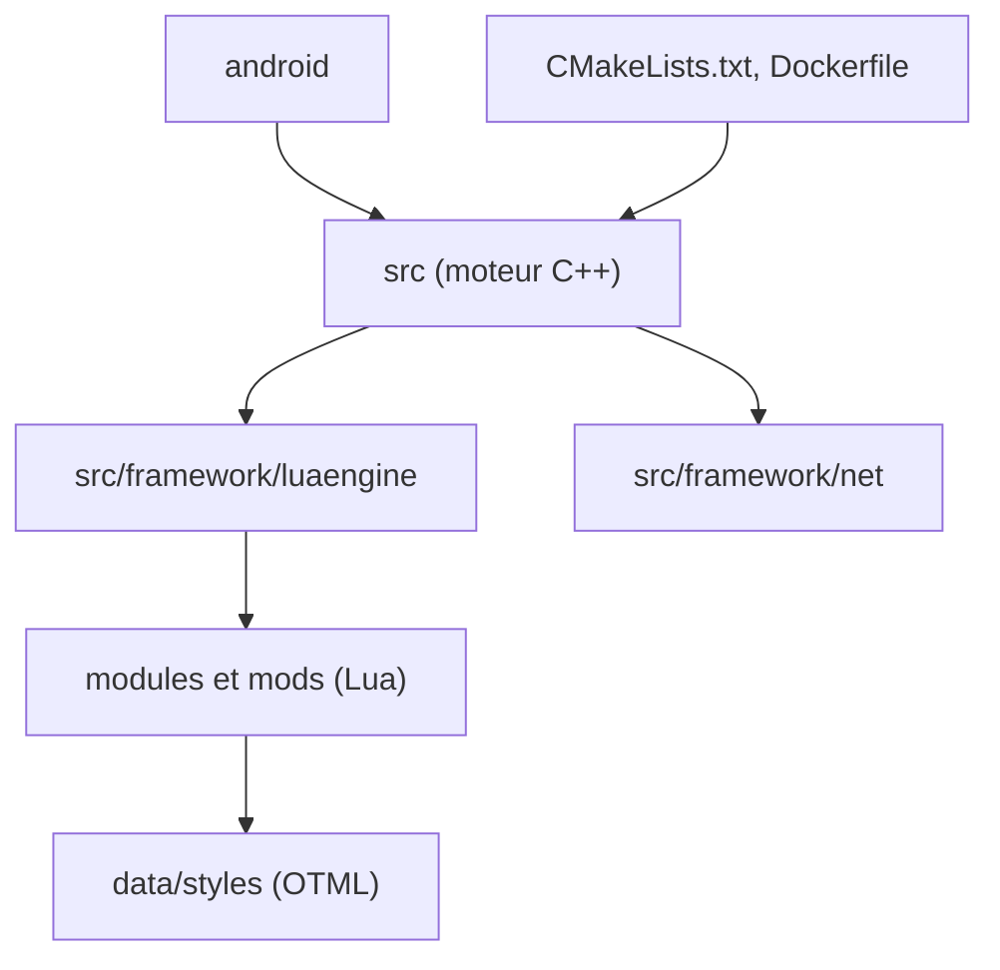

# mehah/otclient

> Alternative Tibia client for OTServ servers, scriptable in Lua, written in C++20.

## The problem
The official Tibia client is closed and hard to modify for private servers.

## What it actually does
Multi-threaded C++20 engine with a Lua interface and OTML styles, modules and mods, attached effects, shaders. Clients 7.6 to 15.25. Android and browser ports according to the code.

## How it is wired


## Trying it
```bash
docker build -t mehah/otclient .
xhost +
docker run -it --rm --env DISPLAY --volume /tmp/.X11-unix:/tmp/.X11-unix --device /dev/dri --device /dev/snd mehah/otclient /bin/bash
xhost -
```

## Cost and gotchas
C++ build (see the Wiki) or Docker with X11 and GPU access. You need an OTServ server and the game data. License not identified.

## What it is not
Not a complete game: it is a client. The Apple port is not done.

## Alternatives
- edubart/otclient (the project it comes from).
- theforgottenserver and canary (servers to connect to).

## For you
Ignore: a game project with no link to your field.
