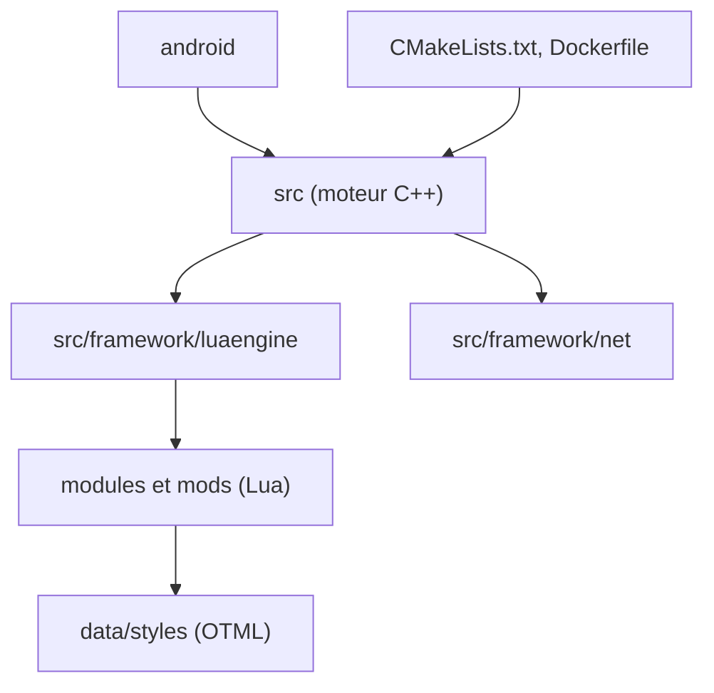

# mehah/otclient

> Client alternatif de Tibia pour serveurs OTServ, scriptable en Lua, écrit en C++20.

## Le problème
Le client officiel de Tibia est fermé et peu modifiable pour les serveurs privés.

## Ce que ça fait vraiment
Moteur C++20 multi-thread avec interface en Lua et styles OTML, modules et mods, effets attachés, shaders. Clients 7.6 à 15.25. Portages Android et navigateur d'après le code.

## Comment c'est branché


## Essayer
```bash
docker build -t mehah/otclient .
xhost +
docker run -it --rm --env DISPLAY --volume /tmp/.X11-unix:/tmp/.X11-unix --device /dev/dri --device /dev/snd mehah/otclient /bin/bash
xhost -
```

## Coût et pièges
Compilation C++ (voir le Wiki) ou Docker avec accès X11 et GPU. Il faut un serveur OTServ et les données du jeu. Licence non identifiée.

## Ce que ce n'est pas
Pas un jeu complet : c'est un client. Le portage Apple n'est pas fait.

## Alternatives
- edubart/otclient (dont il est issu).
- theforgottenserver et canary (serveurs à relier).

## Pour toi
À ignorer : projet de jeu sans lien avec ton métier.

