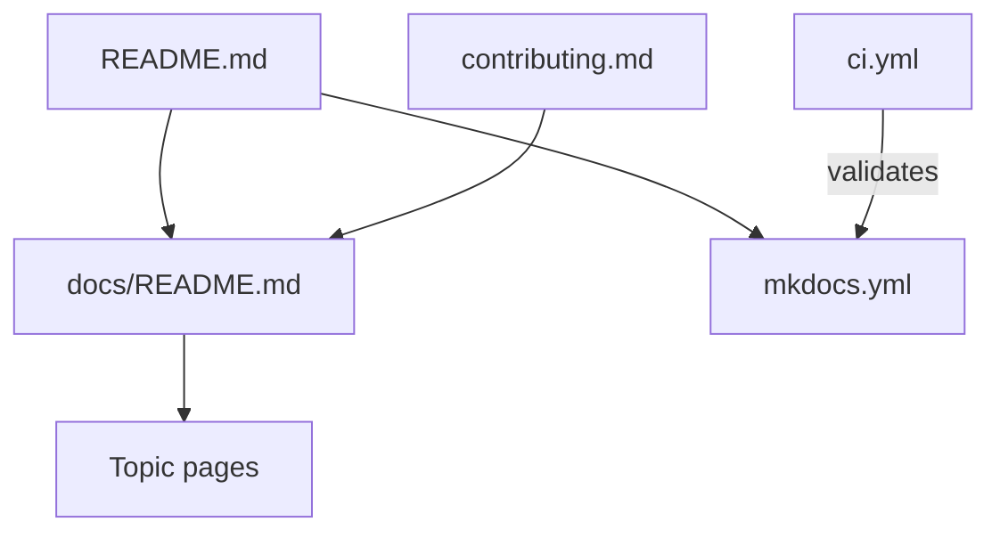

# mehdihadeli/awesome-software-architecture

> Community catalog of software architecture resources, organized by collection and topic.

## The problem
Articles, videos and books on software architecture are scattered and hard to sort by theme.

## What it actually does
A Markdown tree under `docs/` groups resources by collection, sub-collection and topic: AI, cloud, data, DevOps, distributed systems, modeling, patterns and principles. An MkDocs site publishes it and a CI workflow validates the content.

## How it is wired

## Trying it
No documented command: you browse the web app or the `docs/` folder.

## Cost and gotchas
Free. There is nothing to install; quality depends on the links added by contributors.

## What it is not
Not a structured course: a list of links, with no learning path.

## Alternatives
No alternative named in the README.

## For you
Keep an eye on it: a good reference for finding reading on distributed patterns and AI, to consult occasionally.
