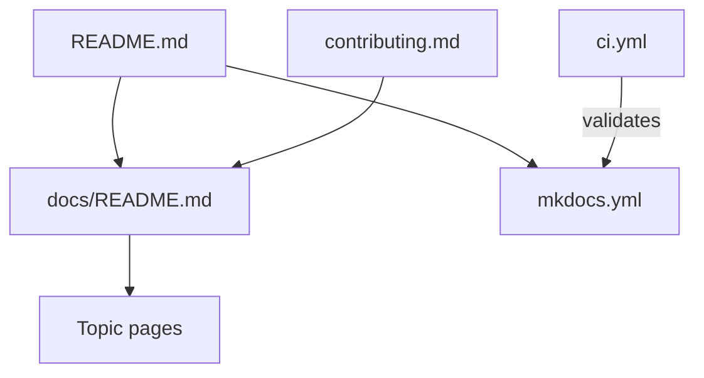

# mehdihadeli/awesome-software-architecture

> Catalogue communautaire de ressources sur l'architecture logicielle, classé par collection et sujet.

## Le problème
Les articles, vidéos et livres sur l'architecture logicielle sont dispersés et difficiles à trier par thème.

## Ce que ça fait vraiment
Un arbre Markdown sous `docs/` regroupe les ressources par collection, sous-collection et sujet : IA, cloud, données, DevOps, systèmes distribués, modélisation, patrons et principes. Un site MkDocs le publie et un workflow CI valide le contenu.

## Comment c'est branché

## Essayer
Aucune commande documentée : on parcourt l'application web ou le dossier `docs/`.

## Coût et pièges
Gratuit. Il n'y a rien à installer ; la qualité dépend des liens ajoutés par les contributeurs.

## Ce que ce n'est pas
Pas un cours structuré : une liste de liens, sans parcours pédagogique.

## Alternatives
Aucune alternative nommée dans le README.

## Pour toi
À surveiller : bonne référence pour trouver des lectures sur les patrons distribués et l'IA, à consulter ponctuellement.

