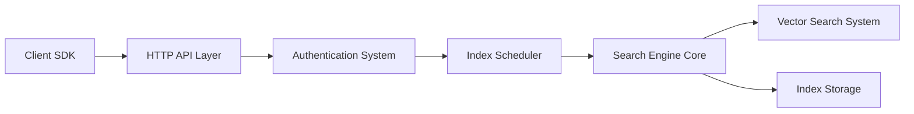

# meilisearch/meilisearch

> Full-text, semantic, and hybrid search engine, self-hosted or cloud-based.

## The problem
To provide a search function that is tolerant of errors, filters results, and is fast, all within an application without relying on a heavy-duty search engine.

## What it actually does
Receives documents via a REST API, indexes them asynchronously, and responds to queries with fault tolerance, filters, facets, sorting, synonyms, geolocations, multi-tenancy, and API keys. Hybrid search with vectors, conversational search, experimental MCP server, and LangChain integration.

## How it is wired


## Trying it
```sh
docker run -it --rm -p 7700:7700 -v $(pwd)/meili_data:/meili_data getmeili/meilisearch:latest
curl -L https://install.meilisearch.com | sh
```

## Cost and gotchas
Free community edition; the Enterprise edition (sharding, S3 snapshots) prohibits production without a commercial agreement (BSL 1.1). The cloud offers a 14-day trial. Anonymized telemetry is enabled by default and can be disabled.

## What it is not
This is not the primary repository. The README mentions two versions and third-party crates that are provided by the vendor, but the license is not identified by GitHub.

## Alternatives
Algolia, Elasticsearch, Typesense, OpenSearch, Pinecone, Qdrant (as mentioned in the README).

## For you
Suitable for a simple hybrid search, either for RAG (Retrieval-Augmented Generation) or application, while verifying the version and telemetry data.
