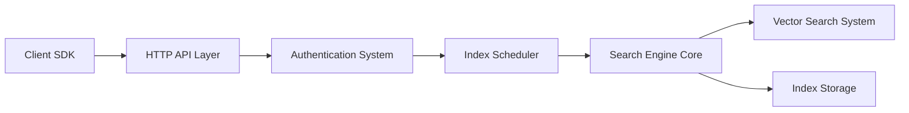

# meilisearch/meilisearch

> Moteur de recherche plein texte, sémantique et hybride, auto-hébergé ou en cloud.

## Le problème
Offrir une recherche tolérante aux fautes, filtrée et rapide dans une application sans exploiter un moteur lourd.

## Ce que ça fait vraiment
Reçoit des documents via une API REST, les indexe de façon asynchrone et répond aux requêtes avec tolérance aux fautes, filtres, facettes, tri, synonymes, géorecherche, multi-tenancy et clés d'API. Recherche hybride avec vecteurs, recherche conversationnelle, serveur MCP expérimental, intégration LangChain.

## Comment c'est branché


## Essayer
```sh
docker run -it --rm -p 7700:7700 -v $(pwd)/meili_data:/meili_data getmeili/meilisearch:latest
curl -L https://install.meilisearch.com | sh
```

## Coût et pièges
Édition communautaire gratuite ; l'édition Enterprise (sharding, instantanés S3) interdit la production sans accord commercial (BSL 1.1). Le cloud a 14 jours d'essai. Télémétrie anonymisée activée par défaut, désactivable.

## Ce que ce n'est pas
Pas une base de données principale. Le README mentionne deux éditions et des crates tierces vendorisées : la licence n'est pas identifiée par GitHub.

## Alternatives
Algolia, Elasticsearch, Typesense, OpenSearch, Pinecone, Qdrant (comparaisons citées dans le README).

## Pour toi
À adopter pour une recherche hybride simple de RAG ou d'application, en vérifiant l'édition et la télémétrie.

