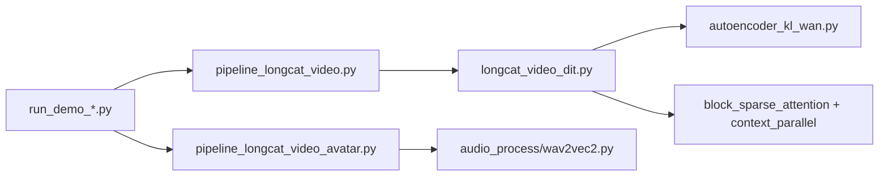

# meituan-longcat/LongCat-Video

> 13.6-billion-parameter video generation model (text, image, continuation), with an audio-driven avatar variant.

## The problem
Open video models mostly generate short clips. LongCat-Video aims at long videos, without color drift or quality loss.

## What it actually does
A single model handles text-to-video, image-to-video and video continuation. The repository contains only inference and demos, not training: a DiT backbone, a video autoencoder, flow-matching sampling, block-sparse attention and multi-GPU context parallel. An Avatar branch adds audio (wav2vec2, then Whisper-large-v3 for 1.5).

## How it is wired


## Trying it
```bash
conda create -n longcat-video python=3.10
conda activate longcat-video
pip install -r requirements.txt
huggingface-cli download meituan-longcat/LongCat-Video --local-dir ./weights/LongCat-Video
torchrun run_demo_text_to_video.py --checkpoint_dir=./weights/LongCat-Video --enable_compile
```

## Cost and gotchas
GPU mandatory, torch 2.6 + CUDA 12.4 and flash-attn to compile. Weights to download from Hugging Face. Required VRAM is not quantified in the README.

## What it is not
Not a ready-to-use service nor a training tool. The MOS scores come from an internal benchmark: in image-to-video, the model is below Wan 2.2 on overall quality (3.17 versus 3.26). Usage warnings remain the user's responsibility.

## Alternatives
- Wan 2.2 (T2V/I2V-A14B): also open, 28B MoE, best overall score in image-to-video.
- Veo3: proprietary, best text alignment in their comparison.

## For you
Watch: MIT-licensed video model, actively updated, but it demands a heavy GPU and only takes off for those doing video generation.
