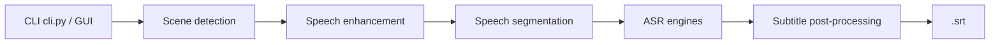

# meizhong986/WhisperJAV

> Local subtitle generator for Japanese adult videos, with ASR pipelines tuned against hallucinations.

## The problem
Whisper hallucinates on long, noisy audio or audio full of non-verbal vocalizations; blind denoising sometimes makes things worse.

## What it actually does
Chain: audio extraction, scene detection, optional enhancement, VAD segmentation, ASR, Japanese post-processing (repetition filters, non-verbal lines, timing). Modes balanced, fidelity, fast, faster, qwen, anime-whisper, transformers, plus a two-pass ensemble with merging. Translation through Ollama, DeepSeek, Gemini, etc. An end-of-run table shows success per file. GUI and CLI.

## How it is wired


## Trying it
```bash
pip install torch torchaudio --index-url https://download.pytorch.org/whl/cu128
pip install "whisperjav[all] @ git+https://github.com/meizhong986/whisperjav.git"
whisperjav video.mp4
whisperjav video.mp4 --mode balanced --sensitivity aggressive
```

## Cost and gotchas
NVIDIA GPU recommended (CPU: 30-60 min per hour of video). About 3 GB of models on first launch. Cloud translation: paid APIs.

## What it is not
Adult content: to be used only in compliance with the law. Results vary with audio quality.

## Alternatives
No alternative named in the README (it builds on faster-whisper, stable-ts, Qwen3-ASR).

## For you
Keep an eye on it: a good case study of robust ASR (VAD, ensemble, anti-hallucination filters) reusable for your difficult audio, but niche and single-maintainer.
