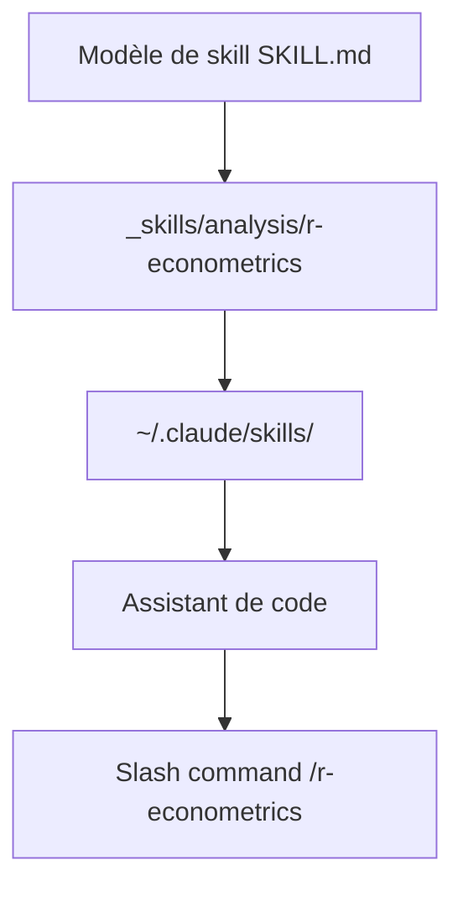

# meleantonio/awesome-econ-ai-stuff

> Collection of SKILL.md skills for economists: Stata, R, Python, LaTeX, paper writing.

## The problem
Economics research workflows (Stata cleaning, econometrics, LaTeX tables) are repeated over and over without coding assistants knowing them.

## What it actually does
Catalog of skills organized by stage: ideation, literature review, LaTeX templates, data, econometrics (IV, DiD, RDD), writing, communication, engineering. Compatible with Claude Code, Cursor, Gemini CLI, Codex.

## How it is wired
Simplified diagram based on the sheet, no diagram provided.



## Trying it
```bash
mkdir -p ~/.claude/skills
cp -r _skills/analysis/r-econometrics ~/.claude/skills/
```
Then in the assistant: `/r-econometrics Run a DiD analysis on my treatment data`.

## Cost and gotchas
Free, but you need an installed coding assistant (and its subscription or key). License present but not identified by GitHub. Skill quality is not assessed in the README.

## What it is not
Not software: a collection of instruction files. Does not replace methodological validation by a human.

## Alternatives
None cited in the README.

## For you
Watch: interesting for picking up econometrics or LaTeX skills, to be reviewed before use given the unclear license.
