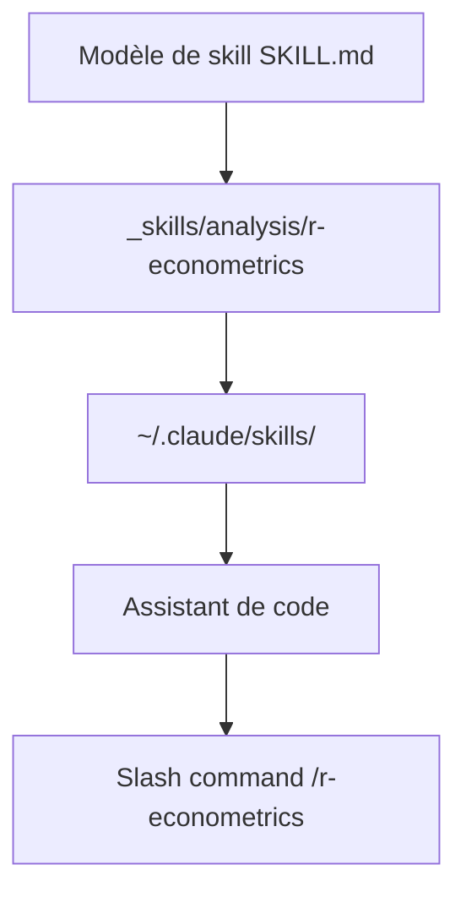

# meleantonio/awesome-econ-ai-stuff

> Collection de skills SKILL.md pour économistes : Stata, R, Python, LaTeX, rédaction d'articles.

## Le problème
Les workflows de recherche en économie (nettoyage Stata, économétrie, tableaux LaTeX) se répètent sans que les assistants de code les connaissent.

## Ce que ça fait vraiment
Catalogue de skills classés par étape : idéation, revue de littérature, modèles LaTeX, données, économétrie (IV, DiD, RDD), rédaction, communication, ingénierie. Compatibles Claude Code, Cursor, Gemini CLI, Codex.

## Comment c'est branché
Schéma simplifié d'après la fiche, sans diagramme fourni.



## Essayer
```bash
mkdir -p ~/.claude/skills
cp -r _skills/analysis/r-econometrics ~/.claude/skills/
```
Puis dans l'assistant : `/r-econometrics Run a DiD analysis on my treatment data`.

## Coût et pièges
Gratuit, mais il faut un assistant de code installé (et son abonnement ou sa clé). Licence présente mais non identifiée par GitHub. Qualité des skills non évaluée dans le README.

## Ce que ce n'est pas
Pas un logiciel : une collection de fichiers de consignes. Ne remplace pas la validation méthodologique par un humain.

## Alternatives
Aucune citée dans le README.

## Pour toi
Surveiller : intéressant pour récupérer des skills d'économétrie ou de LaTeX, à relire avant usage vu la licence floue.

