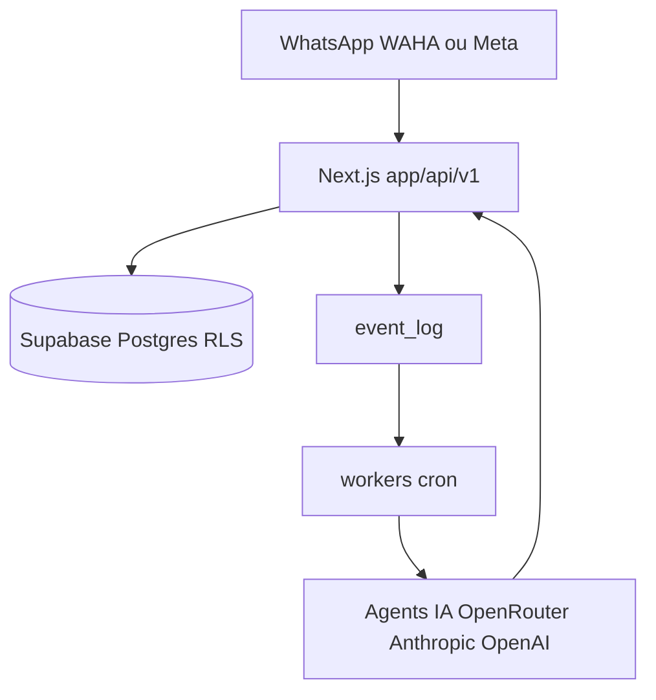

# melgarafael/DeskcommCRM

> Self-hosted open source CRM where AI agents handle sales on WhatsApp, for small businesses.

## The problem
Replying to, qualifying and following up with customers on WhatsApp by hand costs time, and the CRMs on the market are paid.

## What it actually does
Next.js application with Supabase (Postgres, RLS, pgvector): inbox, kanban, contacts, AI agents with per-tenant RAG, follow-ups and WHEN/IF/THEN automations. WhatsApp goes through WAHA (QR code) or Meta's Cloud API. The CRM is exposed via MCP. The Docker installer for VPS handles HTTPS, cron and updates with backup.

## How it is wired
Simplified diagram based on the sheet, no diagram provided.



## Trying it
```bash
git clone https://github.com/melgarafael/DeskcommCRM.git
cd DeskcommCRM
bash hostgator-setup-kit/install.sh
```

## Cost and gotchas
Docker VPS (4 GB of RAM recommended), domain, Supabase account, OpenRouter, Anthropic or OpenAI key: the AI bill is on you. The free Supabase plan does not back up on its own. README in Portuguese, 469 open issues.

## What it is not
Not a serverless tool: you administer a VPS. The HostGator link is an affiliate link. No guarantee against a WhatsApp ban, despite the announced protections.

## Alternatives
- Kommo, Octadesk, Intercom: cited as paid solutions the project aims to replace.

## For you
Worth watching: a good case study of AI agents with multi-tenant RAG, but too specific to WhatsApp commerce for direct MLOps use.
