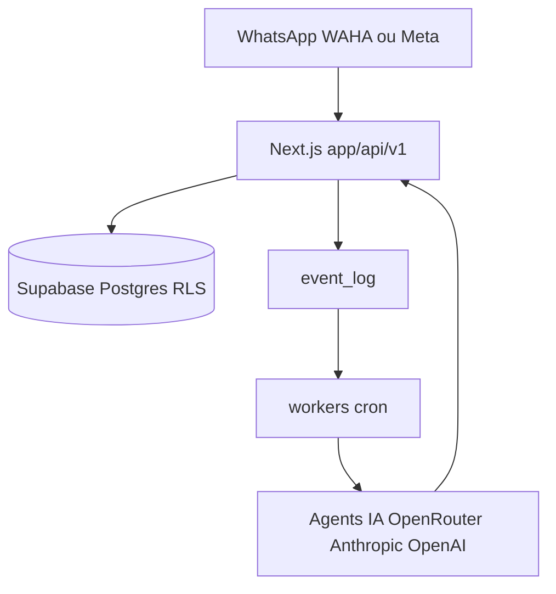

# melgarafael/DeskcommCRM

> CRM open source auto-hébergé où des agents d'IA gèrent les ventes sur WhatsApp, pour petites entreprises.

## Le problème
Répondre, qualifier et relancer des clients sur WhatsApp à la main coûte du temps, et les CRM du marché sont payants.

## Ce que ça fait vraiment
Application Next.js avec Supabase (Postgres, RLS, pgvector) : boîte de réception, kanban, contacts, agents IA avec RAG par locataire, relances et automatisations QUAND/SI/ALORS. WhatsApp passe par WAHA (QR code) ou l'API Cloud de Meta. Le CRM est exposé via MCP. L'installeur Docker pour VPS gère HTTPS, cron et mises à jour avec sauvegarde.

## Comment c'est branché
Schéma simplifié d'après la fiche, sans diagramme fourni.



## Essayer
```bash
git clone https://github.com/melgarafael/DeskcommCRM.git
cd DeskcommCRM
bash hostgator-setup-kit/install.sh
```

## Coût et pièges
VPS Docker (4 Go de RAM recommandés), domaine, compte Supabase, clé OpenRouter, Anthropic ou OpenAI : facture IA à ta charge. Le plan gratuit Supabase ne sauvegarde pas seul. README en portugais, 469 issues ouvertes.

## Ce que ce n'est pas
Pas un outil sans serveur : tu administres une VPS. Le lien HostGator est un lien de partenariat. Aucune garantie contre un bannissement WhatsApp, malgré les protections annoncées.

## Alternatives
- Kommo, Octadesk, Intercom : cités comme solutions payantes que le projet veut remplacer.

## Pour toi
À surveiller : bonne étude de cas d'agents IA avec RAG multi-locataire, mais trop spécifique au commerce WhatsApp pour un usage MLOps direct.

