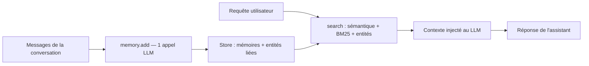

# mem0ai/mem0

> Memory layer for assistants and agents: remember a user's preferences across sessions.

## The problem
An agent starts from zero in every conversation. Pasting the context back by hand bloats the prompt and costs tokens with no guarantee of relevance.

## What it actually does
Stores and retrieves memories at user, session and agent levels. The new algorithm (April 2026) does ADD-only extraction in a single LLM call, with no UPDATE or DELETE: memories accumulate. Entities are extracted, embedded and linked across memories; search merges semantic, BM25 and entity matching, with temporal reasoning. Three forms: pip/npm library, self-hosted Docker server, cloud platform.

## How it is wired


## Trying it
```bash
pip install mem0ai
pip install mem0ai[nlp] && python -m spacy download en_core_web_sm
cd server && make bootstrap
```

## Cost and gotchas
Mem0 requires an LLM, `gpt-5-mini` by default, and `text-embedding-3-small`: OpenAI API key on you. The advertised benchmark figures apply to the managed platform, which contains proprietary optimizations absent from the open-source SDK. Auth on the self-hosted server is enabled by default.

## What it is not
It is not a vector database: it is a layer on top. The published scores are not reproducible as-is in open source. Memory is not free in tokens: ~7K tokens per retrieval advertised.

## Alternatives
- Hosted Qdrant: if you already have your vectors, a migration guide exists.
- Langgraph, CrewAI: integrations cited, for orchestration rather than memory.

## For you
To watch: the open-source version is usable, but compare it with a local solution before depending on the cloud.
