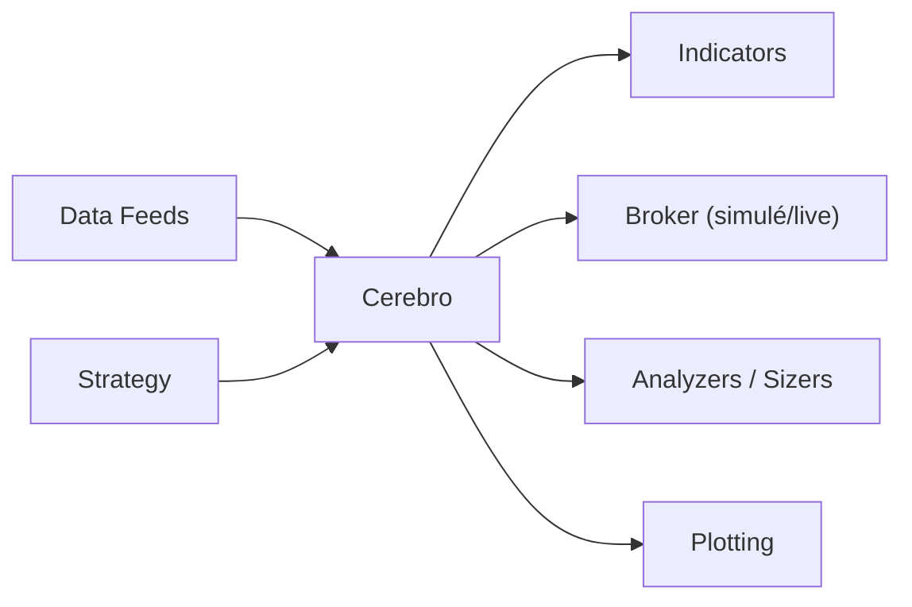

# mementum/backtrader

> Python platform for backtesting and live trading, for algorithmic trading strategies.

## The problem
Testing a trading strategy on historical data, then moving to live trading, requires building your own broker simulator, indicators and charts.

## What it actually does
A `Cerebro` engine that runs one or more strategies on several data feeds and several time frames: 122 built-in indicators (plus TA-Lib), analyzers (Sharpe, SQN), simulated broker (market, limit, stop, OCO orders, commissions, slippage), position sizers, filters, resampling, matplotlib charts. Live trading through Interactive Brokers, Visual Chart, Oanda. The README states Python ≥ 3.2 and no dependency apart from plotting.

## How it is wired


## Trying it
```bash
pip install backtrader
pip install backtrader[plotting]
```

## Cost and gotchas
Free; live trading goes through a third-party broker. GPL-3.0. Last push in 2024-08 (more than a year ago). The Yahoo integration depends on a third-party API whose instability the README notes, and pyfolio is marked obsolete.

## What it is not
It is not a guarantee of profitability: a good backtest says nothing about the future. Issues are no longer used for support.

## Alternatives
No alternative named in the README.

## For you
Watch: a practical framework for backtesting in Python, but not very active; compare with recent tools before committing to it.
