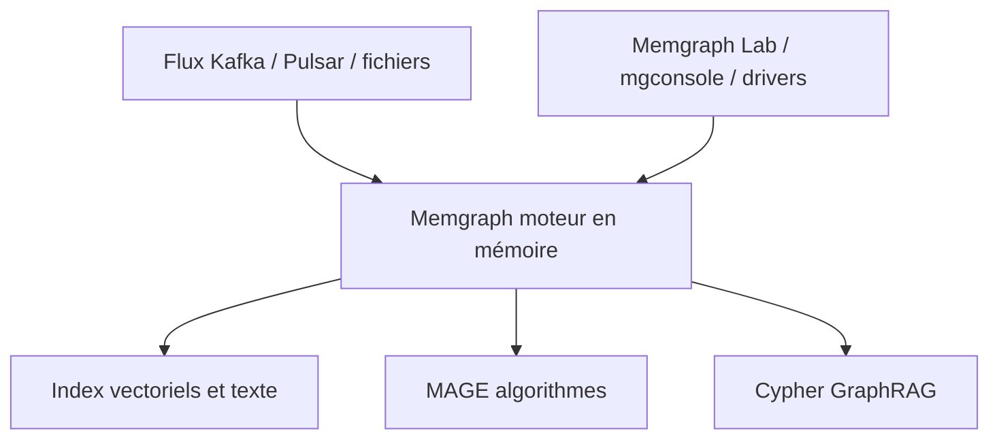

# memgraph/memgraph

> In-memory graph database, Cypher-compatible, for GraphRAG, agent memory and real-time analytics.

## The problem
Connected contexts (relations, multi-hop paths) are poorly queried with a vector index alone, and splitting search across several systems complicates pipelines.

## What it actually does
In-memory C/C++ engine, Cypher queries (Neo4j-compatible), vector, text and geospatial indexes in the same query. MAGE library of more than 40 algorithms (PageRank, communities, GNN), ingestion from Kafka, Pulsar, RedPanda, Parquet, JSONL. High availability through Raft, multi-tenancy and fine-grained access control on the enterprise side.

## How it is wired
Simplified diagram based on the sheet, no diagram provided.



## Trying it
```bash
helm repo add memgraph https://memgraph.github.io/helm-charts
helm install my-memgraph memgraph/memgraph
```

## Cost and gotchas
Data is kept in memory: plan for the RAM. Some features (high availability, multi-tenancy, SSO) belong to the Enterprise edition; a managed Cloud offer on AWS exists. License not recognized by GitHub.

## What it is not
Not a pure vector database nor an analytical warehouse. Speed figures are the vendor's own. The installers are not detailed in the provided README, which points to the website.

## Alternatives
Neo4j is cited only as the Cypher compatibility reference, not as a recommended alternative.

## For you
Worth watching: relevant for a GraphRAG or an agent memory with rich relations, provided you check the license and know what stays in the paid edition.
