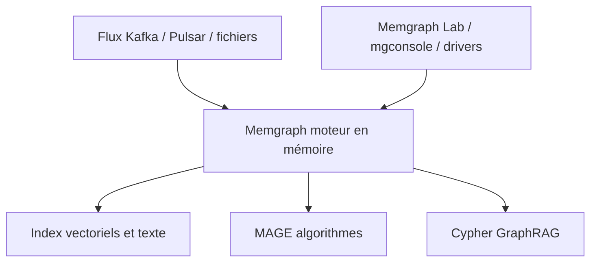

# memgraph/memgraph

> Base de données graphe en mémoire, compatible Cypher, pour GraphRAG, mémoire d'agents et analyses temps réel.

## Le problème
Les contextes connectés (relations, chemins multi-sauts) s'interrogent mal avec un index vectoriel seul, et éclater la recherche sur plusieurs systèmes complique les pipelines.

## Ce que ça fait vraiment
Moteur C/C++ en mémoire, requêtes Cypher (compatible Neo4j), index vectoriels, texte et géospatiaux dans la même requête. Bibliothèque MAGE de plus de 40 algorithmes (PageRank, communautés, GNN), ingestion Kafka, Pulsar, RedPanda, Parquet, JSONL. Haute disponibilité par Raft, multi-tenance et contrôle d'accès fin côté entreprise.

## Comment c'est branché
Schéma simplifié d'après la fiche, sans diagramme fourni.



## Essayer
```bash
helm repo add memgraph https://memgraph.github.io/helm-charts
helm install my-memgraph memgraph/memgraph
```

## Coût et pièges
Données gardées en mémoire : prévoir la RAM. Des fonctions (haute disponibilité, multi-tenance, SSO) relèvent de l'édition Enterprise ; une offre Cloud gérée sur AWS existe. Licence non reconnue par GitHub.

## Ce que ce n'est pas
Pas une base vectorielle pure ni un entrepôt analytique. Les chiffres de vitesse sont ceux de l'éditeur. Les installateurs ne sont pas détaillés dans le README fourni, qui renvoie au site.

## Alternatives
Neo4j est cité seulement comme référence de compatibilité Cypher, pas comme alternative recommandée.

## Pour toi
À surveiller : pertinent pour un GraphRAG ou une mémoire d'agent à relations riches, à condition de vérifier la licence et de savoir ce qui reste dans l'édition payante.

