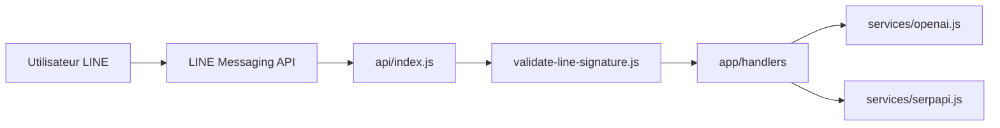

# memochou1993/gpt-ai-assistant

> LINE chat bot connected to the OpenAI API, deployable on Vercel (minimal sheet).

## The problem
Chatting with a GPT assistant from the LINE app, without writing the webhook yourself.

## What it actually does
From the code: `api/index.js` receives the LINE webhook and verifies its signature.
A handlers → commands → actions pipeline, which calls OpenAI (chat, image, transcription).
SerpAPI optional for web search.
Hosting on Vercel or in Docker.

## How it is wired

## Trying it
No command documented in the README (it points to external documentation).

## Cost and gotchas
An OpenAI key and a LINE Developers account are required.

## What it is not
Not maintained as a main project: the author points to "fermi", its successor.

## Alternatives
- fermi: designated successor (Supabase + OpenRouter).

## For you
Ignore: it is a consumer LINE bot, already replaced by its author, and it brings nothing to a data or MLOps profile.
