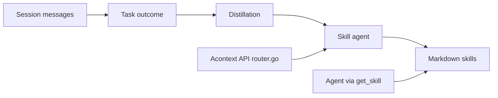

# memodb-io/Acontext

> Memory layer for AI agents that stores what is learned as Markdown skill files.

## The problem
Agent memory is opaque, hard to debug and hard for the user to correct.

## What it actually does
Session messages feed an LLM distillation when a task ends or fails; a "Skill" agent then writes into skill files (a `SKILL.md` schema that you define). On read-back, the agent calls `get_skill` / `get_skill_file`: progressive disclosure, no semantic search. ZIP export is possible. Cloud or self-hosted option.

## How it is wired


## Trying it
```bash
curl -fsSL https://install.acontext.io | sh
mkdir acontext_server && cd acontext_server
acontext server up
pip install acontext
```

## Cost and gotchas
Self-hosting: Docker and an OpenAI key (default model `gpt-4.1`); dependencies on PostgreSQL, S3, Redis, RabbitMQ. The cloud requires an `sk-ac` key, with free credits at the start.

## What it is not
Not a vector database: recall goes through the agent's tools and reasoning. Memory is reliable only if your agent tools know how to call the skills.

## Alternatives
No alternative named in the README.

## For you
Worth watching: an interesting idea (readable, versionable memory) but a heavy stack to self-host; try it through the cloud first.
