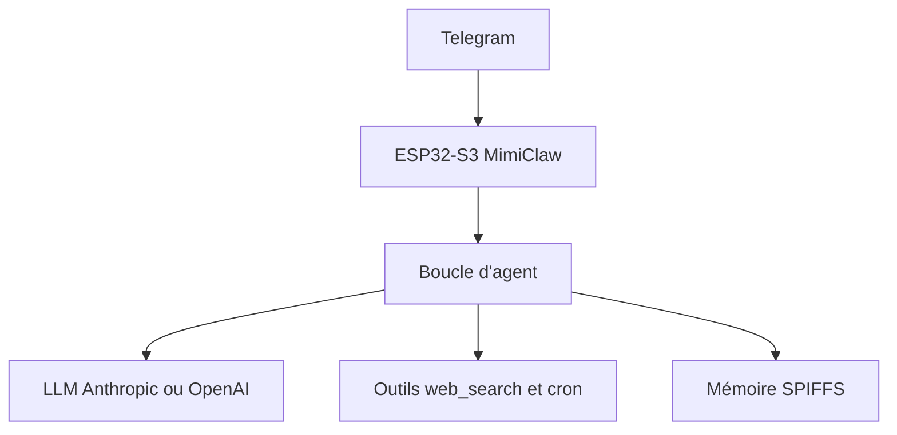

# memovai/mimiclaw

> Pure C AI assistant on a few-euro ESP32-S3 board, controlled through Telegram.

## The problem
Personal AI assistants require a server or PC that is always on, running Linux and Node.js.

## What it actually does
The firmware receives a Telegram message over WiFi, runs an agent loop (ReAct) that calls an Anthropic or OpenAI LLM, uses tools (Tavily or Brave web search, time, cron tasks) and replies. Memory in text files on flash (SOUL.md, MEMORY.md, HEARTBEAT.md), WebSocket gateway, OTA updates.

## How it is wired
Simplified diagram based on the sheet, no diagram provided.



## Trying it
```bash
git clone https://github.com/memovai/mimiclaw.git
cd mimiclaw
idf.py set-target esp32s3
cp main/mimi_secrets.h.example main/mimi_secrets.h
idf.py fullclean && idf.py build
idf.py -p PORT flash monitor
```

## Cost and gotchas
ESP32-S3 board (16 MB flash, 8 MB PSRAM), Telegram token, LLM API key at your expense, ESP-IDF 5.5+. Secrets are compiled into the firmware.

## What it is not
The LLM does not run on the chip: it calls a remote API. Not production-ready: recent project.

## Alternatives
No alternative named in the README (OpenClaw and Nanobot are cited as sources of inspiration).

## For you
Worth watching: a useful curiosity about embedded AI and agents, but dependent on paid APIs.
