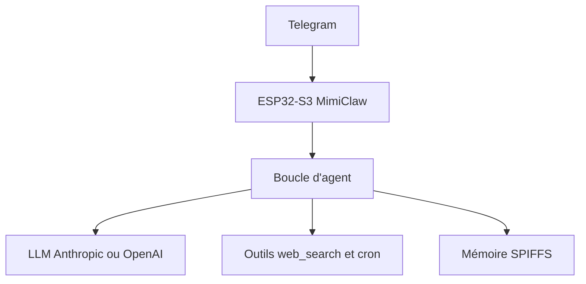

# memovai/mimiclaw

> Assistant IA en C pur sur une carte ESP32-S3 à quelques euros, piloté par Telegram.

## Le problème
Les assistants IA personnels exigent un serveur ou un PC allumé en permanence, avec Linux et Node.js.

## Ce que ça fait vraiment
Le firmware reçoit un message Telegram par WiFi, lance une boucle d'agent (ReAct) qui appelle un LLM Anthropic ou OpenAI, utilise des outils (recherche web Tavily ou Brave, heure, tâches cron) et répond. Mémoire en fichiers texte sur flash (SOUL.md, MEMORY.md, HEARTBEAT.md), passerelle WebSocket, mises à jour OTA.

## Comment c'est branché
Schéma simplifié d'après la fiche, sans diagramme fourni.



## Essayer
```bash
git clone https://github.com/memovai/mimiclaw.git
cd mimiclaw
idf.py set-target esp32s3
cp main/mimi_secrets.h.example main/mimi_secrets.h
idf.py fullclean && idf.py build
idf.py -p PORT flash monitor
```

## Coût et pièges
Carte ESP32-S3 (16 Mo flash, 8 Mo PSRAM), jeton Telegram, clé d'API LLM à ta charge, ESP-IDF 5.5+. Les secrets sont compilés dans le firmware.

## Ce que ce n'est pas
Le LLM ne tourne pas sur la puce : elle appelle une API distante. Pas prêt pour la production : projet récent.

## Alternatives
Aucune alternative nommée dans le README (OpenClaw et Nanobot sont cités comme sources d'inspiration).

## Pour toi
À surveiller : curiosité utile sur l'IA embarquée et les agents, mais dépendante d'API payantes.

