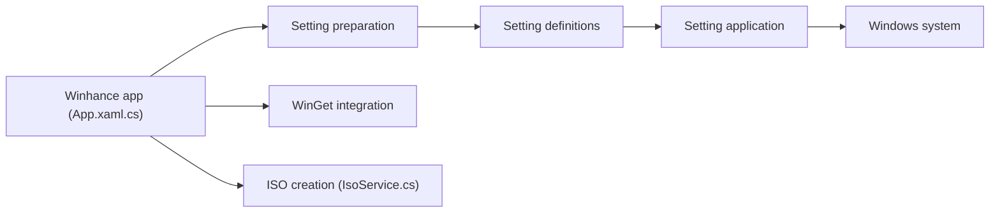

# memstechtips/Winhance

> C# application that cleans, optimizes and customizes Windows 10 and 11 without reinstalling.

## The problem
Windows ships with preinstalled applications and scattered privacy and performance settings, and reinstalling to fix them costs time.

## What it actually does
- Removes or installs Windows applications and features, installs external apps via WinGet.
- Toggles settings: privacy, gaming, updates, power, sound, taskbar, Start menu.
- Exports and imports its settings as a configuration file.
- Advanced tools: creation of custom Windows ISOs (WIMUtil) and autounattend.xml files.

## How it is wired


## Trying it
```powershell
irm "https://get.winhance.net" | iex
```
Or download `Winhance.Installer.exe` (installable and portable versions).

## Cost and gotchas
Free. Modifies system settings: the author calls it "in development". The PowerShell one-liner runs a remote script. Tested on Windows 10 22H2 and Windows 11 23H2 through 25H2.

## What it is not
Not affiliated with Microsoft. Not a project open to contributions: the author states they are not a developer and sometimes decline pull requests. License present but not identified.

## Alternatives
UnattendedWinstall, cited in the README (same improvements, but through a clean Windows installation).

## For you
Ignore: a Windows tuning tool outside the data/AI scope, license to clarify, and it touches sensitive system settings.
