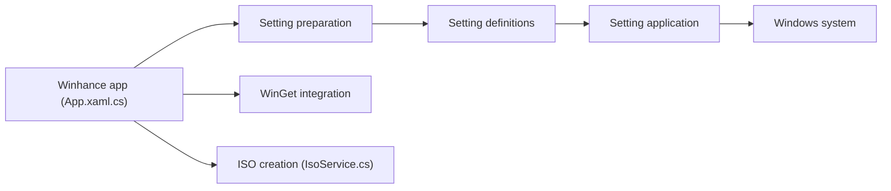

# memstechtips/Winhance

> Application C# qui nettoie, optimise et personnalise Windows 10 et 11 sans réinstallation.

## Le problème
Windows livre des applications préinstallées, des réglages de confidentialité et de performance dispersés, et réinstaller pour les corriger coûte du temps.

## Ce que ça fait vraiment
- Supprime ou installe applications et fonctionnalités Windows, installe des apps externes via WinGet.
- Bascule des réglages : confidentialité, jeux, mises à jour, alimentation, son, barre des tâches, menu Démarrer.
- Exporte et importe ses réglages en fichier de configuration.
- Outils avancés : création d'ISO Windows personnalisés (WIMUtil) et de fichiers autounattend.xml.

## Comment c'est branché


## Essayer
```powershell
irm "https://get.winhance.net" | iex
```
Ou télécharger `Winhance.Installer.exe` (versions installable et portable).

## Coût et pièges
Gratuit. Modifie des réglages système : l'auteur le dit « en développement ». Le one-liner PowerShell exécute un script distant. Testé sur Windows 10 22H2 et Windows 11 23H2 à 25H2.

## Ce que ce n'est pas
Pas affilié à Microsoft. Pas un projet ouvert aux contributions : l'auteur précise ne pas être développeur et refuser parfois les pull requests. Licence présente mais non identifiée.

## Alternatives
UnattendedWinstall, cité dans le README (mêmes améliorations, mais via une installation propre de Windows).

## Pour toi
À ignorer : outil de réglage Windows hors cadre data/IA, licence à clarifier, et il touche à des réglages système sensibles.

