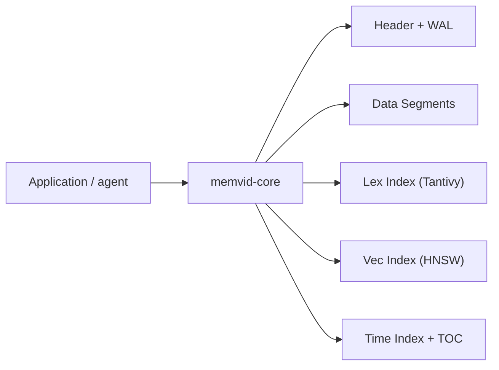

# memvid/memvid

> AI agent memory in a single `.mv2` file: storage, search and history, with no database.

## The problem
Giving an agent long-term memory forces you to set up a separate vector database or RAG pipeline.

## What it actually does
The core is written in Rust (`memvid-core`) and writes immutable, append-only "Smart Frames" into a single file. The file embeds a WAL journal, a full-text index (Tantivy), a vector index (HNSW) and a time index. Features are enabled through Cargo features: PDF, CLIP, Whisper, local ONNX embeddings or OpenAI. Node and Python SDKs and a CLI are announced.

## How it is wired

Everything fits in one `.mv2` file, with no side files.

## Trying it
```bash
pip install memvid-sdk
cargo add memvid-core
cargo run --example basic_usage
```

## Cost and gotchas
Rust 1.85+ for the native route. Local embedding models must be downloaded by hand (120 MB to 1.3 GB). `api_embed` requires `OPENAI_API_KEY`.

## What it is not
The benchmark figures (+35% on LoCoMo, P50 latency) come from the README, with no detailed method given here. It is not a multi-writer storage engine: the model is an append-only file.

## Alternatives
No alternative is named in the README.

## For you
Worth watching: the idea of portable memory in a single file is useful for an agent prototype, but the cited benchmarks have not been verified here.
