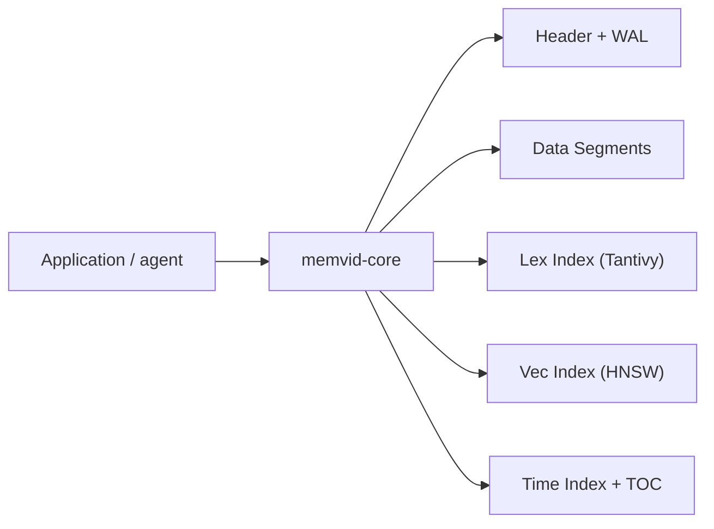

# memvid/memvid

> Mémoire d'agent IA dans un seul fichier `.mv2` : stockage, recherche et historique, sans base de données.

## Le problème
Donner une mémoire longue à un agent oblige à monter une base vectorielle ou un pipeline RAG à part.

## Ce que ça fait vraiment
Le cœur est en Rust (`memvid-core`) et écrit des « Smart Frames » immuables en ajout seul dans un fichier unique. Le fichier embarque un journal WAL, un index plein texte (Tantivy), un index vectoriel (HNSW) et un index temporel. Les fonctions s'activent par features Cargo : PDF, CLIP, Whisper, embeddings ONNX locaux ou OpenAI. SDK Node, Python et CLI annoncés.

## Comment c'est branché

Tout tient dans un fichier `.mv2`, sans fichier annexe.

## Essayer
```bash
pip install memvid-sdk
cargo add memvid-core
cargo run --example basic_usage
```

## Coût et pièges
Rust 1.85+ pour la voie native. Les modèles d'embedding locaux sont à télécharger à la main (120 Mo à 1,3 Go). `api_embed` demande `OPENAI_API_KEY`.

## Ce que ce n'est pas
Les chiffres de benchmark (+35 % sur LoCoMo, latence P50) viennent du README, sans méthode détaillée ici. Ce n'est pas un stockage concurrent multi-écrivains : le modèle est un fichier en ajout seul.

## Alternatives
Aucune alternative nommée dans le README.

## Pour toi
À surveiller : l'idée d'une mémoire portable en un fichier est utile pour un prototype d'agent, mais les benchmarks cités ne sont pas vérifiés ici.

