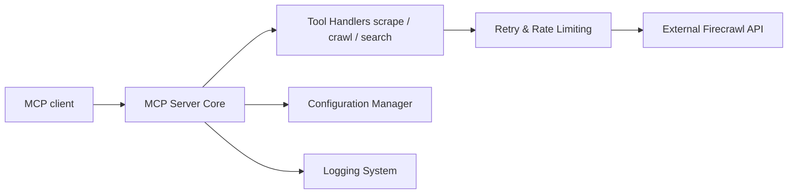

# mendableai/firecrawl-mcp-server

> MCP server giving agents web search, scraping and page interaction via Firecrawl.

## The problem
An agent needs clean, structured, up-to-date web pages, not raw HTML.

## What it actually does
MCP tools: scrape (JSON with schema or markdown), map, crawl, search, file parsing, interact (clicks), asynchronous autonomous research agent, change monitor, developer search and paper search. Hosted endpoint without a key (scrape, search, parse, rate-limited), OAuth or key for the rest. Self-hosting possible via `FIRECRAWL_API_URL`.

## How it is wired


## Trying it
```bash
env FIRECRAWL_API_KEY=fc-YOUR_API_KEY npx -y firecrawl-mcp
```

## Cost and gotchas
Firecrawl credits are consumed per call (search: 2 credits). The crawl, map and agent tools require a key. Crawling can saturate the context: bound limit and depth. Feedback tools are active by default (can be disabled).

## What it is not
Not a step-by-step driven browser: each interact call finishes its turn before handing control back. The cited repository has moved under the firecrawl organization.

## Alternatives
- No alternative is named in the README.

## For you
Adopt to give an agent web capabilities in a few lines; cost tied to Firecrawl credits and data sent to a third party.
