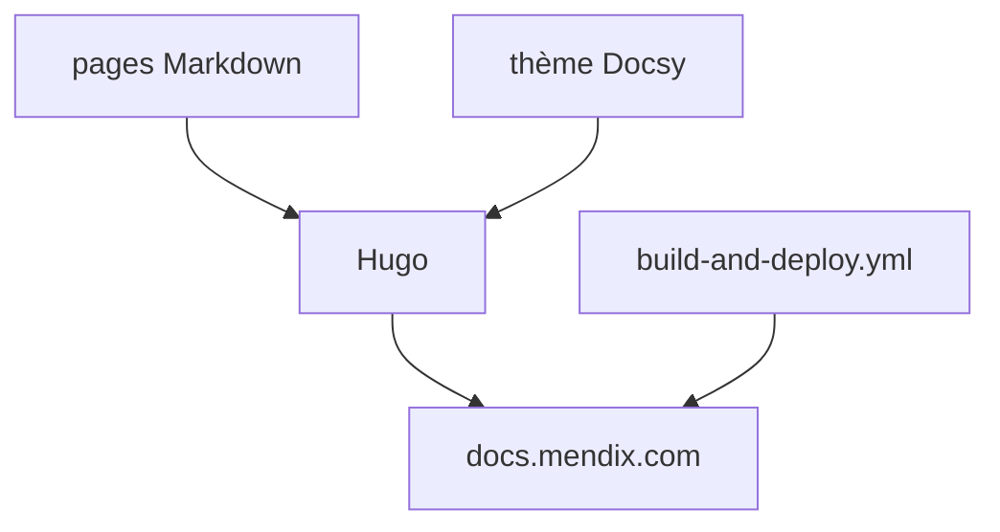

# mendix/docs

> Sources of the official Mendix documentation, built with Hugo, for low-code developers.

## The problem
Users of a low-code platform need up-to-date documentation, open to corrections.

## What it actually does
Repository of the pages served at docs.mendix.com, built with Hugo, Node.js and the Docsy theme. You can contribute from GitHub or a local branch and preview the site. The README points to an MCP server (mendixlabs/mendix-doc.mcp) that gives the docs to an agent.

## How it is wired


## Trying it
```bash
npm install
npm run build
./node_modules/.bin/hugo server --environment development
```
Then http://localhost:1313/.

## Cost and gotchas
Free. On Windows, clone path limited to 50 characters. On Mac, a "too many open files" error is possible; `--renderToDisk` reduces memory use.

## What it is not
Not the Mendix platform itself: only its documentation, under CC-BY-4.0.

## Alternatives
No alternative named in the README.

## For you
Ignore: documentation of a low-code product; the cited MCP server is the only AI-related lead.
