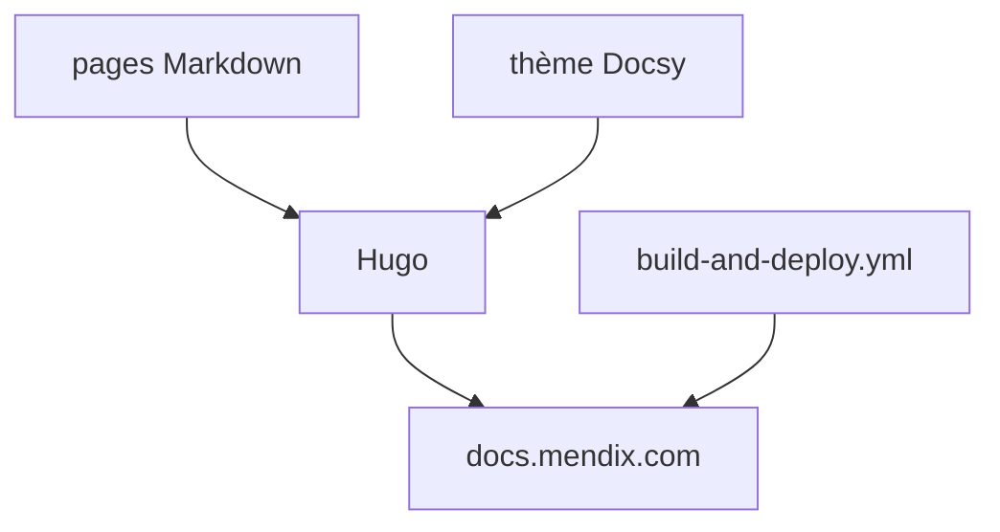

# mendix/docs

> Sources de la documentation officielle Mendix, construite avec Hugo, pour développeurs low-code.

## Le problème
Les utilisateurs d'une plateforme low-code ont besoin d'une documentation à jour, ouverte aux corrections.

## Ce que ça fait vraiment
Dépôt des pages servies sur docs.mendix.com, construit avec Hugo, Node.js et le thème Docsy. On peut contribuer depuis GitHub ou une branche locale et prévisualiser le site. Le README signale un serveur MCP (mendixlabs/mendix-doc.mcp) qui donne les docs à un agent.

## Comment c'est branché


## Essayer
```bash
npm install
npm run build
./node_modules/.bin/hugo server --environment development
```
Puis http://localhost:1313/.

## Coût et pièges
Gratuit. Sous Windows, chemin de clone de 50 caractères maximum. Sur Mac, erreur « too many open files » possible ; `--renderToDisk` allège la mémoire.

## Ce que ce n'est pas
Pas la plateforme Mendix elle-même : seulement sa documentation, sous CC-BY-4.0.

## Alternatives
Aucune alternative nommée dans le README.

## Pour toi
À ignorer : documentation d'un produit low-code ; le serveur MCP cité est la seule piste liée à l'IA.

