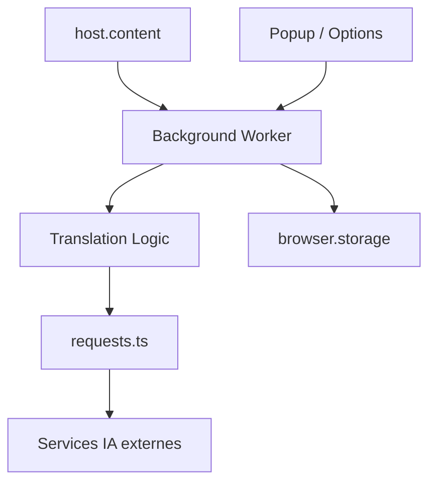

# mengxi-ream/read-frog

> AI language-learning browser extension: translation of pages, selections and subtitles.

## The problem
Reading and watching content in a foreign language forces you to copy-paste into a translator and lose context.

## What it actually does
Translates pages (bilingual or translation-only mode), selections and subtitles on YouTube, X and Netflix, with page context. Custom AI actions, text-to-speech, spaced-repetition flashcards, request batching. Over 20 providers via the Vercel AI SDK, plus Google Translate, Microsoft Translate and DeepLX.

## How it is wired

## Trying it
No installation command in the README: extension to install from the Chrome, Edge or Firefox stores. The architecture diagram cites `pnpm dev`, `pnpm zip` and `pnpm zip:firefox`, outside the provided README.

## Cost and gotchas
AI providers require your own API keys. Some features (YouTube audio transcription) are reserved for the Pro and Ultra plans. Dual GPLv3 and commercial license.

## What it is not
Not an offline tool: page content goes to the chosen provider.

## Alternatives
Immersive Translate, of which this is a free alternative (cited in the README).

## For you
Ignore for your line of work: a language-learning tool, unrelated to data, AI or MLOps, and with a license carrying commercial clauses.
